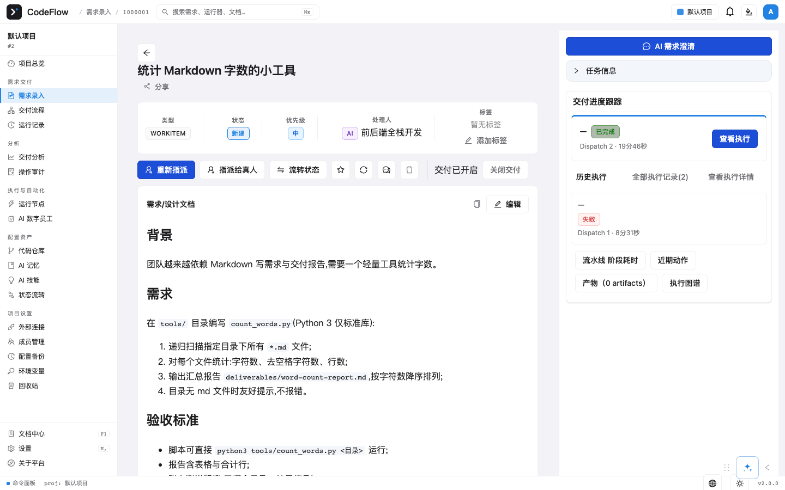
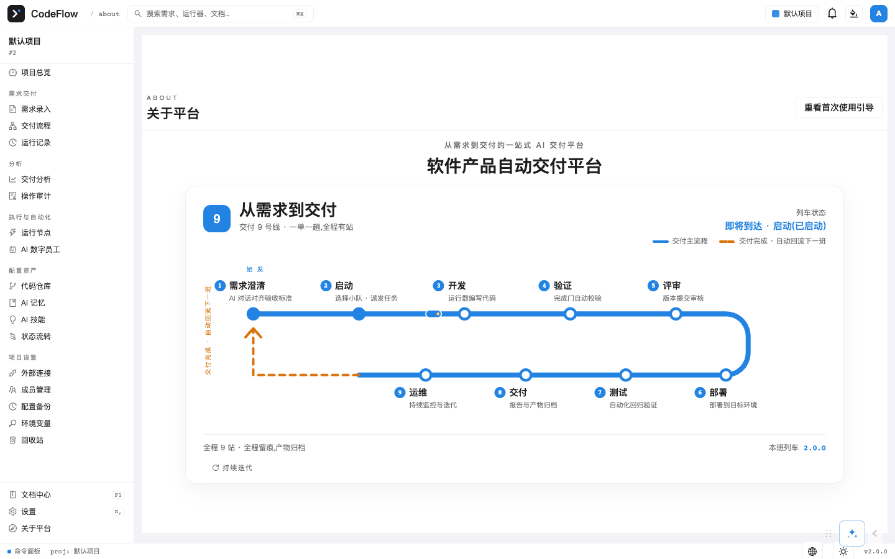

# CodeFlow · AI 需求交付平台

> 需求写完，AI 数字员工接着干，交付产物和结论都摆在台面上。

开源自托管的 AI 需求交付平台：需求进平台后由数字员工按交付流程自动完成分析、开发、测试、验证与交接；每一步的派发记录、运行日志与交付产物全程留痕可回看——AI 负责把活干完，拍板权在人。

[License](platform/ainative/LICENSE) · [Python](https://www.python.org/) · [Spring Boot](https://spring.io/) · [Docker Compose](platform/docker-compose.yml)



| 指标 | 实测结果 |
|---|---:|
| 单条需求全自动交付耗时 | 20～50 分钟 |
| 澄清阶段真实反问 | 最多 19 个问题 |
| 一次交付归档产物 | 8 个文件 |
| 压测类交付 | 20 并发 × 50 次，50/50 成功，QPS 1975.77 |

以上数字来自真实交付环境的运行记录（含完整审计日志），不是设计目标值。

## 快速开始

```bash
git clone https://github.com/qsumm/CodeFlow.git && cd CodeFlow
cd platform
./deploy.sh up
```

`deploy.sh up` 会生成密钥 → 构建镜像 → 启动 seekdb 与应用 → 等待健康检查通过，并打印访问地址。

打开 `http://localhost:7001/register` 注册首个用户（**建组织即成为管理员**），随后进入引导页完成四步上手：认识模型 → 跑起运行节点 → 认识预置阵容 → 打通需求源。

端口可覆盖：`APP_PORT=8080 ./deploy.sh up`。其余命令：`down`（停容器，保留数据卷）/ `restart` / `status` / `logs`。

## 为什么是它

> 交付拖期的根源，不在"写得慢"，而在"上下文一直在人手里丢掉"。

该项目希望让一次交付从需求到验收全程有据可查，同时不让 AI 越过人的判断直接改状态。

## 核心功能

### 需求交付主线

- **交付流程模板**：分析与分支准备 → 编码与测试 → 验证与交付 → 交接评审，多角色自动接棒；每步带完成门，不达标不往下走。
- **需求澄清对话**：开工前先反问一轮（边界、技术栈、验收标准、回滚策略），结论落成 `spec.md` 与 `plan.md` 随派发注入。
- **交付进度跟踪**：当前派发、历史执行、阶段耗时、产物清单同页可见；失败可原样重试，前几轮记录一条不少。
- **交付结论回写**：交付备注经幂等 marker 写回源头工单平台，重复回写不产生重复评论。

### 数字员工与编队

- **AI 数字员工**：可执行角色，绑定客户端类型与模型；配置变更走版本审核，审批通过才生效。
- **编队**：多个数字员工 + 角色构成 + 交付流程的交付阵型；启动交付时选编队。
- **Agent 客户端 6 种**：`Claude Code` · `Codex CLI` · `Cursor CLI` · `Gemini CLI` · `Qoder CLI` · `Qoder CLI CN`。

### 模型接入

任意 Anthropic 兼容端点：Claude / MiniMax / GLM / Kimi / DeepSeek / 私有模型。配置 `ANTHROPIC_BASE_URL` + `ANTHROPIC_AUTH_TOKEN` + `ANTHROPIC_MODEL` 即接。

### 外部工单平台

- **禅道 ZenTao 18.10+**：绑定产品 → 需求与缺陷自动入库 → 派发数字员工 → 交付备注回写源头。**已真实闭环验证**：建需求 → 开发交付 → 建缺陷 → 修复 → 回写，全程有记录。
- **TAPD（VIP 版本）**：项目绑定 → 自动拉取需求与缺陷 → 交付结论写回评论；回写结果未知时先按 marker 读回确认，不盲目重发。
- Provider 抽象：绑定、状态映射、回执全 provider 无关，新平台只需实现 `ExternalWorkitemProvider`。

### 执行器运行时（本仓库 `runtime/`，纯标准库）

- 主动连回平台领取任务，**被执行的机器不需要开放入站端口**。
- 心跳与能力声明、任务包下载（sha256 校验）、交付流程逐步执行、澄清会话（`CONVERSATION_TURN` 协议）、交付备注上报。
- 执行器离线时派发按指数退避排队，节点上线自动唤醒。

### 平台能力

工单管理与交付进度跟踪 · 交付分析与操作审计 · 定时任务（按 cron 自动派发 + 定时需求 + 运行记录）· 代码仓库 / AI 记忆 / AI 技能 / 状态流转配置 · MCP 令牌与工具 · IM 机器人（钉钉 / 飞书）· 平台品牌主题 · 帮助中心 · 暂停恢复与执行控制 · 完整 REST API 与 Swagger 文档。

## 六个核心设计

| 设计 | 摘要 |
|---|---|
| 澄清前置 | 开工前反问一轮，验收标准先写成可执行检查项 |
| 完成门卡步 | 每步达标才往下走，不达标停在当前步并说明原因 |
| 执行器主动回连 | 运行节点向外领任务，不要求被控机器开放入站端口 |
| 失败留痕可重试 | 每次派发独立编号，前几轮执行记录全部保留 |
| 产物随交付归档 | 过程文档、脚本、报告入库，可下载可预览 |
| 验收结论由人给 | 平台只回写交付结论，不代改外部单据状态 |
| 定时交付可排期 | 按 cron 自动派发数字员工，每次触发生成需求并留运行记录 |

## 它做什么 / 不做什么

**做：**

需求录入与澄清、交付流程编排、数字员工派发执行、过程与产物留痕、失败重试、交付结论回写、交付度量与审计、外部工单平台双向同步。

**不做：**

不代改禅道 / TAPD 等外部单据的完成状态，不替人做验收判断，不在无人确认下执行变更，不运行白名单之外的任意命令。

## 交付过程看得见


每一轮派发的步骤、耗时、日志与产物都在需求详情页可回看；执行轨迹带时间戳，输出流自动折叠。



## 部署

### 前置条件

| 项目 | 要求 | 说明 |
|---|---|---|
| Docker 与 Compose | Docker 20.10+、Compose v2 | 可通过 `docker compose version` 检查 |
| 内存 | 建议至少 4GB | SeekDB 最低需要 2GB 可用内存 |
| 磁盘 | 至少 10GB 空闲 | 镜像与依赖缓存占主要空间 |
| 端口 | 7001 | 可通过 `APP_PORT` 修改 |
| 网络 | 首次构建可访问镜像源与 Maven 仓库 | 默认使用国内镜像源 |

### 三步部署

#### 1. 克隆仓库

```bash
git clone https://github.com/qsumm/CodeFlow.git && cd CodeFlow
```

#### 2. 启动服务

```bash
cd platform
./deploy.sh up
```

首次运行会自动生成 `platform/.env`（JWT 密钥、凭据加密主密钥、下载密钥，`chmod 600`，请勿提交）。已有 `.env` 时复用，密钥不会重置。

也可手动执行：

```bash
cd platform
docker compose up -d --build
```

首次构建需要下载依赖与前端产物，通常为 3～8 分钟；后续构建可复用缓存。

#### 3. 注册首个用户

浏览器打开 `http://localhost:7001/register` 注册第一个账号，该账号自动成为平台管理员（建组织即成为管理员）。

### 验证是否成功

```bash
curl -s -o /dev/null -w "%{http_code}\n" http://127.0.0.1:7001/v3/api-docs
cd platform && ./deploy.sh status
```

预期结果：

- 上面这条命令返回 `200`（该端点无需登录，直接反映服务是否就绪）。
- `platform-app-1` 与 `platform-seekdb-1` 均为 `Up` / `healthy`。
- 浏览器能打开登录页并注册成功。

### 接入执行器

平台跑起来后，还需要一个执行器节点来真正干活（可与平台同机，也可分机部署）：

```bash
pip install -e .                                     # 或直接 python -m runtime.daemon(纯标准库)

export AINATIVE_BASE_URL=http://localhost:7001
export AINATIVE_ADMIN_USER=admin
export AINATIVE_ADMIN_PASSWORD=...
python scripts/register_executor.py --agent-id <数字员工ID> --workspace-id <工作空间ID> \
  --out runtime.env --provider claude

# 追加模型通道
echo 'AINATIVE_AGENT_CMD=claude' >> runtime.env
echo 'ANTHROPIC_BASE_URL=https://<anthropic-compatible-endpoint>' >> runtime.env
echo 'ANTHROPIC_AUTH_TOKEN=<your-token>' >> runtime.env
echo 'ANTHROPIC_MODEL=<model-id>' >> runtime.env

# 自检 + 常驻
set -a; . ./runtime.env; set +a
ainative --check-config && ainative --once-smoke
ainative                                     # 或 python -m runtime.daemon,常驻等待派发
```

约束：**同一个 executorId + token 同时只允许一个 daemon 实例**（服务端单会话，后来者会把先来者顶下线）。

### 接口文档

服务启动后可直接查阅全量接口契约（由代码自动生成，随代码演进）：

| 入口 | 地址 |
|---|---|
| Swagger UI | `http://localhost:7001/swagger-ui.html` |
| OpenAPI JSON | `http://localhost:7001/v3/api-docs` |

需要对外关闭时，设置环境变量 `AINATIVE_SWAGGER_ENABLED=false`。

### 从旧版本升级

```bash
cd platform
./deploy.sh up
```

`up` 会保留 `platform/.env` 与数据库卷，数据不丢。注意：**更换环境部署会产生新密钥，旧库里的加密数据不可迁移**；`AINATIVE_SECRET_MASTER_KEY` 用于外部平台凭据加解密，多节点必须一致，更换后需重新保存绑定。

## 常见问题

### 注册后看不到平台配置等入口

首个注册用户才是管理员。若先前已有账号被占用，可在 `platform/ainative/server-v2/src/main/java/com/ainative/v2/auth/UserDao.java` 校正 `is_admin`，或直接清库重来。

### 派发一直停在"排队中"

看交付进度跟踪里的等待原因：**等待运行节点上线** = 执行器没连上（检查 daemon 是否存活、是否同一 executorId 起了两个实例）；**运行节点容量已满** = 在跑的任务太多，等空闲或加节点。排队走指数退避并在上线后自动唤醒，不需要手工重发。

### 数字员工交付失败了先看什么

交付进度跟踪 → 失败派发 → 查看执行：日志里通常是模型端点问题（配额 / 网络）、仓库权限问题，或步骤完成门未达标。修复后点「重试」。

### 平台流转完了，禅道状态怎么没变

设计如此：平台只回写交付备注，不代改禅道单据状态。「已解决 / 关闭」请回禅道侧确认后手工操作。

### 换了环境部署后外部绑定全部失效

`AINATIVE_SECRET_MASTER_KEY` 变了，旧的密文解不开。恢复原密钥，或在外部连接里重新保存一次绑定。

### 执行器反复在线 / 离线抖动

多半是同一 executorId + token 起了两个 daemon 实例，后来的把先前的顶下线。先排查是不是两份 env 在跑。

### 想换模型

改执行器 env 的 `ANTHROPIC_BASE_URL` / `ANTHROPIC_AUTH_TOKEN` / `ANTHROPIC_MODEL` 后重启 daemon。平台侧不绑定模型，模型归执行器。

## 安全

- 外部平台凭据以 AES 加密存库，接口只返回掩码。
- MCP 令牌仅在创建时展示一次完整 URL，列表里只有前缀，不可反查。
- 写操作与未登录访问在控制器层统一校验（10401）。
- 敏感操作全部留痕，可在操作审计页按类型过滤查看。
- 漏洞可通过 GitHub Security Advisories 私下报告。

## 🤝 贡献指南

欢迎提交 Issue 和 Pull Request。项目尤其重视真实交付中暴露的问题：派发卡死、回写不生效、产物丢失、口径不一致等。

### 流程：先开 Issue，再动手

1. 创建 Issue，说明现象、根因和影响。
2. 创建 `fix/<issue号>-<短描述>` 分支。
3. 提交 PR，并使用 `Closes #N`。
4. 合并变更。

Issue 应包含真实日志、复现步骤、预期与实际结果、运行环境和严重程度。

### 本地测试

服务端接口与单元测试：

```bash
cd platform/ainative/server-v2
scripts/run-tests.sh                    # 全量:40 个用例(接口集成 + 单元)
scripts/run-tests.sh -Dtest='*ApiTest'  # 只跑接口集成
```

脚本会自起专用 MySQL 容器并按生产同一份 schema 建表，宿主无需安装 Maven。执行器侧：

```bash
python -m pytest tests -q
```

## 文档

- **用户操作手册**：[`docs/19-用户操作手册.md`](docs/19-用户操作手册.md)（图文版，面向使用者；PDF 版见 `docs/manual-pdf/`）
- **开发规范与流程**：[`docs/00-开发规范与流程.md`](docs/00-开发规范与流程.md)
- **运行器运维**：[`docs/21-执行器运维能力.md`](docs/21-执行器运维能力.md) · **发布流程**：[`docs/20-运行器npm包发布流程.md`](docs/20-运行器npm包发布流程.md)
- **走查与交付验证**：[`docs/24-演示前全量走查与真实交付验证报告.md`](docs/24-演示前全量走查与真实交付验证报告.md)

## 作者

一鸣 · 公众号「一鸣AI编程」

> 这个平台从第一行代码到数字员工交付引擎的完整过程——每一次设计取舍、每一个踩过的坑——都在公众号里连载。

公众号「一鸣AI编程」：真实交付复盘 / AI 编程实战 / 这个平台的全过程，更新不迷路。

## License

平台源码以 MIT License 分发（见 [`platform/ainative/LICENSE`](platform/ainative/LICENSE)）。
