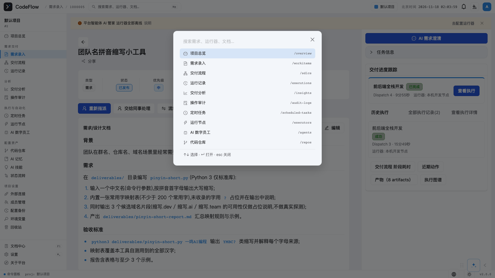
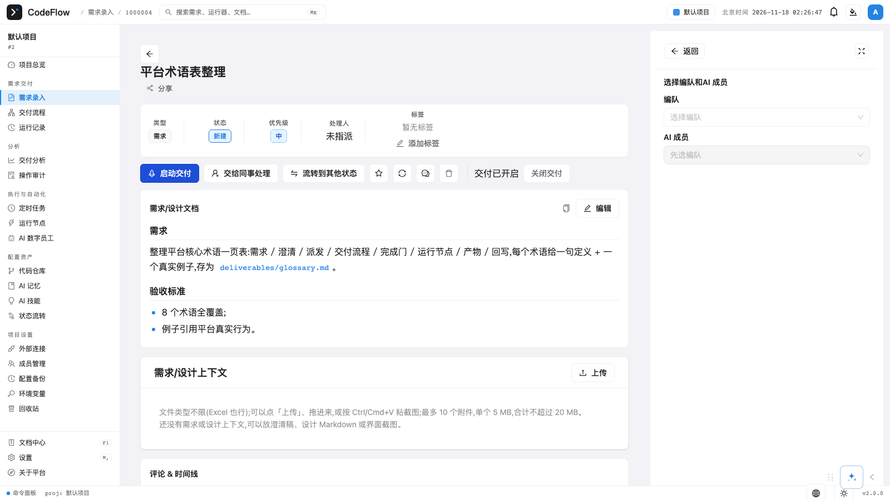
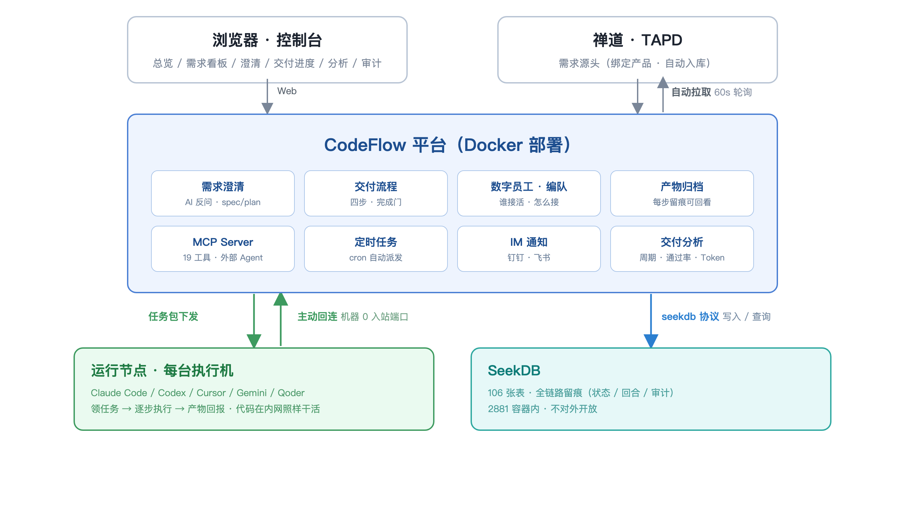

<div align="center">

# CodeFlow · AI 需求交付平台

**需求说清楚，剩下的 AI 干，证据链摆在你面前。**

[](LICENSE)
[](https://www.python.org/)
[](https://spring.io/)
[](platform/docker-compose.yml)

</div>

开源自托管的 **AI 需求交付平台**：需求进平台后由数字员工按交付流程自动完成澄清、分析、开发、测试、验证与交接；每一步的派发记录、运行日志与交付产物全程留痕可回看，交付结论自动写回需求源头——**AI 负责把活干完，拍板权在人**。

---

## 一次真实交付的完整数字

| | |
|---|---|
| **20～50 分钟** | 单条需求从「启动交付」到「验收就绪」的全自动耗时 |
| **19 个** | AI 澄清阶段真实反问的问题数（边界 / 技术栈 / 验收标准 / 回滚策略） |
| **8 个** | 一次交付自动归档的产物（方案 / 代码 / 测试输出 / 部署记录分开存放） |
| **0 个** | 需要开放的入站端口（运行节点主动回连，代码在内网照样干活） |

以上数字来自真实交付环境的运行记录（含完整审计日志），不是设计目标值。

## 快速开始

```bash
git clone https://github.com/qsumm/CodeFlow.git && cd CodeFlow/platform
./deploy.sh up
```

`deploy.sh up` 会自动生成密钥（`.env`，chmod 600）→ 构建镜像 → 启动 seekdb 与应用 → 等待健康检查通过，最后打印访问地址。首次构建约 5～10 分钟（前端 npm + 后端 Maven，走国内镜像源）；国内网络 clone 不稳时用镜像加速：

```bash
git clone https://gh-proxy.com/https://github.com/qsumm/CodeFlow.git && cd CodeFlow/platform
```

浏览器打开 `http://localhost:7001/register` 注册首个用户（**建组织即成为管理员**），随后进入引导页完成四步上手：认识模型 → 跑起运行节点 → 认识预置阵容 → 打通需求源。

## 为什么是它

你有没有过这种下午：需求散在禅道、群里、口头里，两周后没人说得清当时到底要什么；AI 写代码很快，但每次都是你亲自发起——把需求翻成话喂给它、盯着它跑、验证它的产出、把结论同步回工单。一个人手上压五条需求，切一次丢一次上下文。

这个平台把那段流程交给 AI——但不是让 AI 直接拍板。它的哲学写在代码里：

**真正拖慢交付的，是上下文在人和工具之间反复丢失。写代码的速度救不了这个。**

## 核心功能

**需求交付主线**

- **需求澄清对话** — 开工前 AI 先反问一轮（实测最多 19 问），结论落成 `spec.md` 与 `plan.md` 随派发注入
- **交付流程模板** — 分析与分支准备 → 编码与测试 → 验证与交付 → 交接评审，多角色自动接棒；每步带完成门，不达标不往下走
- **交付进度跟踪** — 当前派发、历史执行、阶段耗时、产物清单同页可见；失败可原样重试，前几轮记录一条不少
- **交付结论回写** — 交付备注经幂等 marker 写回源头工单平台，重复回写不产生重复评论

**数字员工与编队**

- **数字员工** — 可执行角色，绑定客户端类型与模型，人设双文件（SOUL.md 业务背景 / AGENT.md 工作方法）派发时随任务包下发
- **编队** — 多个数字员工 + 角色构成 + 交付流程的交付阵型；启动交付时选编队
- **Agent 客户端 6 种** — Claude Code · Codex CLI · Cursor CLI · Gemini CLI · Qoder CLI · Qoder CLI CN

**模型接入**

任意 Anthropic 兼容端点：Claude / MiniMax / GLM / Kimi / DeepSeek / 私有模型。配置 `ANTHROPIC_BASE_URL` + `ANTHROPIC_AUTH_TOKEN` + `ANTHROPIC_MODEL` 即接，模型归执行器，平台不绑定。

**外部工单平台**

- **禅道 ZenTao 18.10+** — 绑定产品 → 需求与缺陷自动入库 → 派发数字员工 → 交付备注回写源头。已真实闭环验证：建需求 → 开发交付 → 建缺陷 → 修复 → 回写，全程有记录
- **TAPD（VIP 版本）** — 项目绑定 → 自动拉取 → 结论写回评论；回写结果未知时先按 marker 读回确认，不盲目重发
- Provider 抽象：绑定、状态映射、回执全 provider 无关，新平台只需实现 `ExternalWorkitemProvider`

**执行器运行时（纯标准库，零第三方依赖）**

主动连回平台领取任务，被执行的机器**不需要开放任何入站端口**；心跳与能力声明、任务包 sha256 校验下载、交付流程逐步执行、澄清会话协议、交付备注上报；执行器离线时派发按指数退避排队，节点上线自动唤醒。

**平台能力**

工单管理与交付进度跟踪 · 交付分析与操作审计 · 定时任务（按 cron 自动派发 + 定时需求 + 运行记录）· 代码仓库 / AI 记忆 / AI 技能 / 状态流转配置 · MCP Server（19 个工具，外部 Agent 直接操作平台）· IM 机器人（钉钉 / 飞书）· 平台品牌主题 · 帮助中心 · 完整 REST API 与 Swagger 文档

## 六个核心设计

| 设计 | 一句话 |
|---|---|
| 澄清前置 | 开工前反问一轮，验收标准先写成可执行检查项——需求说不清，它救不了，但它会先把"没说清"问出来 |
| 完成门卡步 | 每步达标才往下走，不达标停在当前步并说明原因 |
| 执行器主动回连 | 运行节点向外领任务，不要求被控机器开放入站端口——防火墙后、NAT 后、云安全组零改动 |
| 失败留痕可重试 | 每次派发独立编号，前几轮执行记录全部保留，失败原样重试 |
| 产物随交付归档 | 过程文档、脚本、报告入库，可下载可预览 |
| 验收结论由人给 | 平台只回写交付结论，不代改外部单据状态——"已解决"必须由人在禅道侧按下 |

## 它做什么 / 不做什么

**做：** 需求录入与澄清、交付流程编排、数字员工派发执行、过程与产物留痕、失败重试、交付结论回写、交付度量与审计、外部工单平台双向同步。

**不做：** 不代改禅道 / TAPD 等外部单据的完成状态，不替人做验收判断，不在无人确认下执行变更，不运行白名单之外的任意命令。

## 交付过程看得见



每一轮派发的步骤、耗时、日志与产物都在需求详情页可回看；执行轨迹带时间戳，输出流自动折叠。





架构一屏：任务包下发、运行节点主动回连；交付结论只回写，不代改状态。

## 部署

### 前置条件

| 项 | 要求 | 说明 |
|---|---|---|
| Docker + Compose | Docker 20.10+，compose v2 | `docker compose version` 能打印版本即可 |
| 内存 | 建议 ≥ 4GB | SeekDB 官方要求可用内存 ≥ 2GB；不足时它不报错、直接退出（见常见问题） |
| 磁盘 | ≥ 10GB 空闲 | 镜像与依赖缓存占主要空间 |
| 端口 | 7001（平台）、33060（数据库） | 端口可覆盖：`APP_PORT=8080 ./deploy.sh up` |
| 网络 | 首次构建需访问镜像源与 Maven/npm | 已默认走国内镜像源，无需自备梯子 |

### 三步部署

```bash
# ① 克隆（国内网络不稳时用上方镜像加速地址）
git clone https://github.com/qsumm/CodeFlow.git && cd CodeFlow/platform

# ② 一键部署：生成密钥 → 构建 → 启动 → 等就绪 → 打印访问地址
./deploy.sh up

# ③ 浏览器打开 http://localhost:7001/register，注册首个用户 = 平台管理员
```

手动分步也可以：`docker compose up -d --build` 然后跟踪 `./deploy.sh logs`。首次构建约 5～10 分钟，之后重建走缓存秒级。启动顺序是「数据库就绪 → 自动建表 → 起 HTTP 服务」，首次 40～180 秒——这期间 curl 报 Connection reset、数据库显示 Starting 都是正常现象，`deploy.sh` 已替你等。

### 验证是否成功

```bash
curl -s http://127.0.0.1:7001/v3/api-docs | head -c 100     # 期望返回 JSON（该端点无需登录）
./deploy.sh status                                          # platform-app-1 / platform-seekdb-1 均为 Up
```

浏览器打开 `http://localhost:7001/register` 注册成功、登录后左侧能看到「需求录入 → AI 数字员工 → 交付分析」全套菜单，即部署完成。

接入执行器（真正干活的节点，可与平台同机）：

```bash
pip install -e .                       # 或直接 python -m runtime.daemon（纯标准库）
python scripts/register_executor.py --agent-id <数字员工ID> --workspace-id <工作空间ID> \
  --out runtime.env --provider claude
export AINATIVE_AGENT_CMD=claude       # 或绝对路径
python -m runtime.daemon               # 常驻等待派发
```

### 从旧版本升级

```bash
cd platform && ./deploy.sh up
```

`up` 会保留 `.env` 与数据库卷，数据不丢。注意：**更换环境部署会产生新密钥，旧库里的加密数据不可迁移**（`AINATIVE_SECRET_MASTER_KEY` 多节点必须一致）。

## 常见问题

| 现象 | 原因与解法 |
|---|---|
| 数据库容器反复 Restarting，日志只有 `Seekdb process exited unexpectedly` | 资源不足。SeekDB 对资源不足不报错、直接退出：按顺序核对 ① 磁盘空闲充足 ② 可用内存 ≥ 2GB（`free -m` 看 available）③ 停同机其它数据库/Java 服务。加 swap 实测无效 |
| git clone 超时 / end of file | 国内网络访问 GitHub 不稳，重试 2～3 次；持续不通用镜像：`git clone https://gh-proxy.com/https://github.com/qsumm/CodeFlow.git` |
| 首次构建卡在 npm / Maven | 依赖已默认走国内镜像源；仍卡时重试即可（BuildKit 缓存层会在成功后让重建秒级） |
| 端口被占用 | `APP_PORT=8080 ./deploy.sh up`（不用改文件，打印的访问地址会跟着变） |
| 注册后看不到平台配置等入口 | 首个注册用户才是管理员；若已有账号占用，清库重来或联系管理员提升权限 |
| 派发一直停在"排队中" | 看交付进度跟踪里的等待原因：**等待运行节点上线** = 执行器没连上；**运行节点容量已满** = 在跑的任务太多。排队走指数退避并在上线后自动唤醒，不需要手工重发 |
| 数字员工交付失败了先看什么 | 交付进度跟踪 → 失败派发 → 查看执行：通常是模型端点问题（配额/网络）、仓库权限、或步骤完成门未达标。修复后点「重试」 |
| 平台流转完了，禅道状态没变 | 设计如此：平台只回写交付备注，不代改禅道单据状态。「已解决/关闭」请回禅道侧确认后手工操作 |
| 换了环境部署后外部绑定全部失效 | `AINATIVE_SECRET_MASTER_KEY` 变了，旧密文解不开。恢复原密钥，或在外部连接里重新保存绑定 |
| 想换模型 | 改执行器 env 的 `ANTHROPIC_BASE_URL` / `ANTHROPIC_AUTH_TOKEN` / `ANTHROPIC_MODEL` 后重启 daemon。模型归执行器 |
| 手册与界面不一致 | 以平台实际界面为准。手册随版本更新（当前 v2.1.1），欢迎在 Issue 中反馈 |

### 数据与卸载

```bash
./deploy.sh down      # 停服务，保留数据卷
./deploy.sh down -v   # 连数据卷一起删（不可恢复）
```

数据在 Docker 卷 `platform_seekdb-data`（工单 + 会话 + 产物记录）与 `platform_app-artifacts`（产物文件）；备份即导出这两个卷。

## 与开源同类工具对比

CodeFlow 与 Paseo / Conductor / Happy Coder 这类「Agent 编排工作台」解决不同的问题：它们管理**你正在跑的 Agent 会话**，CodeFlow 管理**一条需求从说不清到验收完**的全过程。Paseo 列基于 2026-11 源码比对。

| # | 能力 | CodeFlow（本平台） | Paseo | 直接用 Claude Code |
|---|---|---|---|---|
| 1 | 需求澄清对话（反问 → spec/plan 落档） | ✅ | ❌ 无需求语义 | ❌ |
| 2 | 交付流程模板 + 完成门卡步 | ✅ | ❌ | ❌ |
| 3 | 数字员工 / 编队 / 派发执行 | ✅ | ◐ daemon 编排会话 | ❌ |
| 4 | 产物随交付归档 + 操作审计 | ✅ | ◐ 会话记录 | ❌ |
| 5 | 外部工单双向同步（禅道 / TAPD，只回写结论） | ✅ | ❌ | ❌ |
| 6 | 交付指标（周期 / 通过率 / Token）+ 审计 | ✅ | ◐ Token 用量 | ❌ |
| 7 | 定时任务自动交付（cron 触发 + 运行记录） | ✅ | ◐ 定时运行 | ❌ |
| 8 | MCP Server 供外部 Agent 操作平台 | ✅ 19 工具 | ✅ | ❌ |
| 9 | 移动端远程接管 | ❌ | ✅ 原生 App | ❌ |
| 10 | Git worktree 并行隔离 | ❌ 会话目录隔离 | ✅ | ❌ |

缺的 9、10 两项在路线图上；把工作台能力补进交付平台也是明确的方向。

## 安全

- 外部平台凭据以 AES 加密存库，接口只返回掩码
- MCP 令牌仅在创建时展示一次完整 URL，列表里只有前缀，不可反查
- 写操作与未登录访问在控制器层统一校验（10401）
- 敏感操作全部留痕，可在操作审计页按类型过滤查看
- 漏洞通过 GitHub 安全通告（Security Advisories）私下报告

## 🤝 贡献指南

欢迎提 Issue 和 Pull Request。这个项目最需要的不是「提个功能」，而是把你在真机上踩到的坑修掉——每一条派发卡死、每一次回写不生效、每一处手册与界面不一致，都是最有价值的贡献。

**流程**：① 开 Issue（现象贴真实日志 + 复现步骤 + 期望 vs 实际）→ ② 建 `fix/<issue号>-<短描述>` 分支（一个分支只修一件事）→ ③ 提 PR（`Closes #N`）→ ④ 合并。

**本地测试**（宿主无需安装 Maven，脚本自起专用 MySQL 容器）：

```bash
cd platform/ainative/server-v2
scripts/run-tests.sh                    # 全量:53 个用例(接口集成 + 单元)
scripts/run-tests.sh -Dtest='*ApiTest'  # 只跑接口集成
```

执行器侧：`python -m pytest tests -q`。全量测试必须全绿。

安全漏洞不要开公开 Issue，走 GitHub 安全通告私下报告。

## 文档

- **用户操作手册**（图文版 v2.1.1，25 章 45 图；PDF 适合打印归档）——平台内按 **F1** 打开帮助中心在线预览/下载；完整手册不在开源包内，关注公众号「一鸣AI编程」回复 **codeflow** 获取
- **接口契约**：服务启动后访问 `http://localhost:7001/swagger-ui.html`（由代码自动生成，随代码演进）

## License

[GPL-3.0](LICENSE)。第三方依赖的许可与归属见 [`NOTICE`](NOTICE)。

完整操作手册与设计文档不在开源包内：关注公众号「一鸣AI编程」回复 **codeflow** 获取。

## 作者

一鸣 · 公众号「一鸣AI编程」

> 这个平台从第一行代码到数字员工交付引擎的完整过程——每一次设计取舍、每一个踩过的坑——都在公众号里连载。

官网：**[codeflow.com.cn](https://www.codeflow.com.cn)** · 公众号「一鸣AI编程」：真实交付复盘 / AI 编程实战 / 这个平台的全过程，更新不迷路。觉得有用的话，给仓库点个 Star ⭐，就是最好的支持。

<div align="center">


**微信扫码关注公众号「一鸣AI编程」**

回复 `codeflow` 获取用户操作手册（图文版 v2.1.1）、部署包与演示环境

</div>
