# 19 · 用户操作手册

> 版本:v2.1.0(2026-11-17) · 适用平台:CodeFlow 2.0.0
> 适用读者:使用平台的研发 / 产品 / 测试同学,以及负责接入禅道、TAPD 与运行节点的管理员

**这本手册解决什么**:需求写了三页、开发理解偏十里;排期等一周、写码只要一天;进度全靠问、交付全靠催;换个人接手、上下文全丢——这些交付痛点,就是 CodeFlow 的用武之地。你把需求说清楚(AI 澄清会帮你问对问题),分析、编码、测试、验证、评审、部署由 AI 数字员工按交付流程自动完成,全程留痕、产物归档,人只做澄清与验收。下面按你的实际动线讲清每一步。

## 文档说明

> EN:ABOUT THIS DOCUMENT
> 摘要:这本手册面向使用和评估 CodeFlow 的研发、产品、测试同学与平台管理员,完整介绍平台的功能边界、配置方式与日常用法。

### 适用读者

| 你是谁 | 你最关心 | 建议从哪读起 |
|---|---|---|
| 研发工程师 | 怎么把活交给 AI 数字员工、过程怎么看 | 第 5、6、7 章 |
| 产品 / 项目负责人 | 交付进度、返工率、一眼看到卡点 | 第 4、17 章 |
| 测试工程师 | 验收标准怎么写、产物在哪 | 第 5、6、20 章 |
| 平台管理员 | 部署、运行节点、外部系统接入 | 第 10、12、13(TAPD 为 VIP 专享)、16 章 |
| 评估 / 选型者 | 平台做什么、不做什么、值不值 | 第 1、2、20 章 |

### 全书结构

全书分三部分,按"先认识、再会用、后查阅"的顺序编排:

- **第一部分 · 认识产品**(第 1~2 章):平台定位、核心价值、界面骨架、菜单索引。用 20 分钟读完,就知道它是什么、边界在哪。
- **第二部分 · 使用指南**(第 3~20 章):从注册到日常使用的主线路径。跟着做一遍,即可独立把需求交给 AI 数字员工交付。
- **第三部分 · 参考**(第 21~25 章):已知边界、默认参数、常见问题、修订记录与联系支持。不用通读,用到即查。

### 这本手册不讲什么

- 不讲模型怎么选型与调参——那是运行节点侧的工程决策,手册只讲怎么接进来(第 10 章);
- 不讲业务代码怎么写——AI 数字员工按你的仓库与澄清结论写,人做判断;
- 不承诺具体收益——第 1 章的数字来自真实交付环境的运行记录,不是你的预期值。

## 阅读指引

> EN:HOW TO READ THIS MANUAL
> 摘要:不同角色关心的东西不一样,不必从头读到尾。按下表挑对你的路径,十分钟上手。

### 按角色选路径

::: roles
独立开发者 / 一人多项目 | 自己跑通一条需求,不依赖团队配置 | 第 1、3 章 → 第 5、6、7 章 → 第 8、10、16 章
小团队负责人 | 交付进度、返工率、谁卡在哪 | 第 1、4、17 章 → 第 5、7 章 → 第 16 章
平台与效能团队 | 度量口径、Token 成本、流程治理 | 第 1、17 章 → 第 9、21 章 → 第 20、22 章
管理员(部署与接入) | 私有化部署、运行节点、外部系统 | 第 3、10 章 → 第 12、13、15 章 → 第 16、18 章
评估 / 选型者 | 平台边界与真实数据 | 第 1、2 章 → 第 21、22 章 → 第 23 章
:::

### 三条阅读约定

::: callout
界面词 | 按钮、页签、菜单等界面上的文字用「」标出,如「启动交付」「需求录入」;与正文叙述区分开,便于在界面上直接搜到。
图编号 | 配图按「图 章号-序号」编号(如图 5-2 = 第 5 章第 2 张),目录与正文可互查;每张图都取自实机界面。
警示框 | 橙色警示框标出容易踩坑的地方——多为"设计如此"而非故障,逐条读一遍能省很多困惑。
:::

### 只记一件事:最短路径

想先看看平台能干什么,按这四步走,大约 20 分钟:

::: steps
注册并选项目 | 首个注册用户自动成为管理员;所有业务数据都归属项目,先选一个。
跑起一个运行节点 | AI 数字员工由你自己机器上的运行节点驱动,不在浏览器里跑。第 10 章给了三种启动方式。
新建一条需求 | 写清楚标题与需求正文,能上传设计文档更好。
启动交付并跟踪 | 选编队与流程,需求进入执行;在交付进度跟踪里看每一步、拿产物。
:::

## 约定与声明

> EN:CONVENTIONS & NOTICES
> 摘要:阅读本手册前,请先了解文中使用的排版约定、修订记录以及内容的适用范围。

### 排版约定

| 记号 | 含义 |
|---|---|
| `新建任务` | 界面上的菜单、按钮或页签名。连续操作写成「新建任务」→「工程库」→「计划」 |
| `TEST_PASSWORD` | 需要原样输入的内容:变量名、接口路径、命令。 |
| 提示框 | 橙色提示框给出用法建议;蓝色说明框给出边界、前提或需要留意的行为。 |
| 图 5-1 | 截图按「图 章号-序号」编号。截图中的数据来自演示环境,账号信息已做遮盖。 |

### 修订记录

::: revise
| 版本 | 日期 | 主要变化 |
| v2.1.0 | 2026 年 11 月 | 全册版式重构:每章增加整页扉页、章/节两级目录与真实页码;新增关键数字卡、对比表、FAQ、已知边界、参数速查与尾页二维码 |
| v2.0.4 | 2026 年 11 月 | 新增「联系与支持」章与 PDF 封底页(公众号二维码) |
| v2.0.3 | 2026 年 11 月 | 客户演示前整改五项:状态模板按需求类型分域;补「同步外部系统」端点;按钮文案整改;消耗口径统一为 Token;空态友好化 |
| v2.0.2 | 2026 年 11 月 | 全册按最新界面实机重写,改为三部分结构,新增阅读指引、已知边界与默认参数速查,配图重编 |
:::

此处只列最近四个版本,完整记录见第 24 章「版本更新记录」。

### 内容声明

- **以实际版本为准**。产品持续迭代,界面文字与布局可能与截图略有差异;功能行为以你正在使用的版本为准。
- **演示数据**。文中被测系统均为公开演示站点,数字来自演示环境的实际运行记录,不代表在你的业务系统上的效果。
- **边界如实说明**。每项功能的前提与限制写在对应章节的说明框里,并在第 21 章「已知边界与使用须知」集中列出;其中标注「首次使用请先读」的对接项,建议按提示先做一次连通性验证。
- **验收结论由人给出**。工具替人关单,等于把验收责任扔给机器——所以平台只回写交付结论与证据,不代改外部单据状态。

## 目录

---

# 第一部分 · 认识产品

> EN:PART ONE
> 摘要:开工前花 20 分钟读完这一部分:CodeFlow 解决什么问题、不做什么、界面长什么样。已经用过平台的可以直接跳到第二部分。

## 1. 平台概览:CodeFlow 是什么

> EN:PRODUCT OVERVIEW
> 摘要:CodeFlow 是一套从需求到交付的 AI 交付平台——需求说清楚,后面的活 AI 干,人只做澄清与验收。

### 1.1 平台定位

**它不替你想清楚要做什么,它替你把做过的每一步留下来。**

写代码已经很快了,真正拖慢交付的是上下文在人和工具之间反复丢失:需求散落各处、每步做完就散、换人接手全部重来。CodeFlow 把一次交付拆成一条**有状态、可回看、可交接**的交付主线:

::: cards
▸ | 需求怎么进来 | 禅道、TAPD 自动同步,或平台内直接新建;外部来源需求在标题下带来源标识,点一下直达原始单据。
◈ | AI 怎么接活 | 开工前先反问一轮,产出 spec.md 与 plan.md;澄清结论随派发注入执行上下文,不再靠口头对齐。
▤ | 在哪台机器上干 | 运行节点装在你自己的机器上主动连回平台,代码与被测系统可以全在内网,平台不需要访问你的机器。
◫ | 产物和结论怎么留 | 过程文档、脚本、汇总报告归档在需求详情里,可下载可预览;交付结论按渠道回写禅道 / TAPD 评论。
✓ | 人什么时候必须介入 | 澄清时回答、方案确认时点头、验收时判断。工具省掉的是"盯着干活",不是"做判断"。
:::

### 1.2 核心价值与关键数据

从"能跑起来"到"敢用它的结论",每一项能力都围绕可信与可持续来设计。以下数字取自真实交付环境的运行记录:

::: stats
20~50 | 分钟 | 单条需求全自动开发 | 四步交付流程,从澄清到归档的实测耗时区间
19 | 个 | 澄清对话真实反问 | 覆盖边界、技术栈、验收标准、回滚策略四类
8 | 个 | 一次交付归档产物 | 过程文档、工具脚本、汇总报告,全部可下载
0 | 次 | 外部单据代改状态 | 只回写交付结论,关闭与验收仍由人确认
:::

| 实测项 | 数字 |
|---|---|
| 单条需求全自动开发耗时 | 20~50 分钟(四步交付流程) |
| 压测类交付实测 | 20 并发 × 50 次:50/50 成功,QPS 1975.77,错误 0 |
| 全链路交付实测 | 浏览 → 加购 → 下单 → 管理端发货 → 已发货,走通 |
| 澄清对话真实反问 | 最多 19 个问题(边界 / 技术栈 / 验收标准 / 回滚) |

不同团队的需求复杂度、模型选择和运行环境差异很大,建议先用一条真实需求试点,再决定接入团队流程。

### 1.3 它不做什么

划边界比吹功能重要。以下四条是产品设计的底线,不是当前版本的缺失:

::: cards
✕ | 不是"一句话生成整个系统"的魔法 | 需求本身说不清,它救不了——AI 会停下来反问你,这是设计而非故障。
◈ | 不是又一个 AI 编程工具 | Claude Code、Codex、Cursor、Gemini 是干活的手,CodeFlow 是派活、盯进度、收结果、留证据的那一层,不绑厂商。
↔ | 不替代需求管理与协作工具 | 需求在禅道里就从禅道来,交付完把结论写回禅道评论,不让你换掉在用的东西。
✓ | 不能替你验收 | 产物、测试记录、部署结果都留给你,"这算不算做完了"由人回答。
:::

### 1.4 与传统做法的对比

::: compare
| 环节 | 传统做法 | 使用 CodeFlow |
| 需求澄清 | 口头或会议里问,结论散落在聊天记录 | 开工前结构化反问,结论落成 spec.md 与 plan.md 随交付归档 |
| 进度掌握 | 靠问人、靠盯群消息 | 需求详情里实时四步交付流程,卡在哪一步、失败原因直接写明 |
| 失败处理 | 逐条翻日志,人工判断重跑 | 失败派发一键重试,前几轮记录一条不少,失败归因写在面板上 |
| 产物归档 | 散在个人目录与聊天附件 | 过程文档、脚本、汇总报告入库,可下载可预览,随需求长期留存 |
| 需求来源 | 需求、缺陷、群消息各在一处 | 禅道 / TAPD 自动入库,带来源标识,一条需求一条交付轨迹 |
| 状态闭环 | 工具或人随手关单 | 只回写交付结论与证据,"已解决 / 关闭"由人在源头确认 |
:::

### 1.5 适用角色与典型场景

不同角色在同一个平台上各取所需,数据彼此贯通:

::: roles
研发工程师 | 关心活派下去没有、过程能不能回看 | 写需求 → 澄清 → 启动交付 → 在交付进度跟踪里盯四步 → 验收产物
测试工程师 | 关心验收标准清不清楚、证据全不全 | 先用澄清对话把验收标准写成可执行检查项 → 交付后按产物核对
项目负责人 | 关心交付到哪了、哪类需求总返工 | 项目总览看八张 KPI → 交付分析看阶段耗时与返工率 → 定位瓶颈环节
平台管理员 | 关心接入稳不稳、密钥与凭据安全 | 运行节点常驻 + 外部系统绑定 + 主密钥统一 + 操作审计留痕
:::

## 2. 界面结构与个性化

> EN:INTERFACE & PERSONALIZATION
> 摘要:登录后选项目;界面是「顶栏 + 左树 + 内容区 + 状态栏」的统一骨架,主题色与壁纸可换,骨架不变。

### 2.1 登录与项目选择

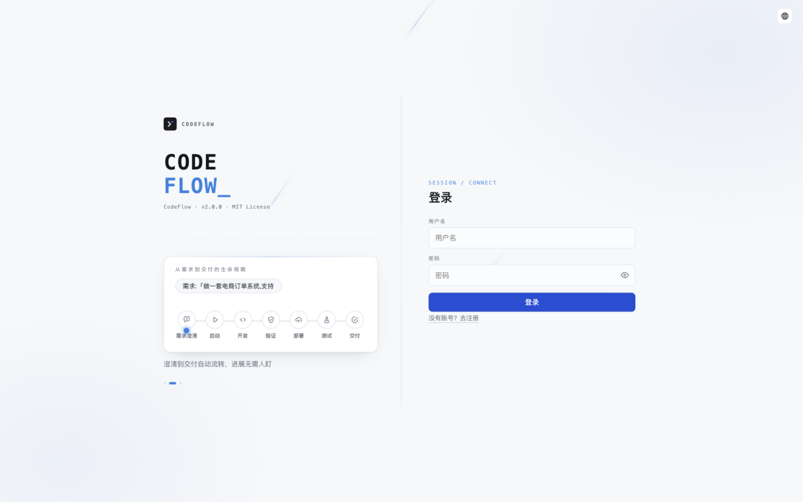
图 2-1　登录页(左:品牌与价值区「光点推进链」;右:登录表单)

- 首次部署通过 `http://<平台地址>:7001/register` 注册首个用户,**建组织即成为管理员**;之后所有成员从登录页进入。
- 登录页背景为 editorial 风格:纸底 + 双光晕 + 流星层;左侧展示平台价值——从需求澄清到交付的七站「光点推进链」,光点走过一段点亮一段,配合轮播的价值主张;右侧为登录表单。
- 登录页固定亮色,不随主题变化;语言跟随浏览器,可在登录后右上角切换。

登录后先选**项目**——所有业务数据都归属某个项目:

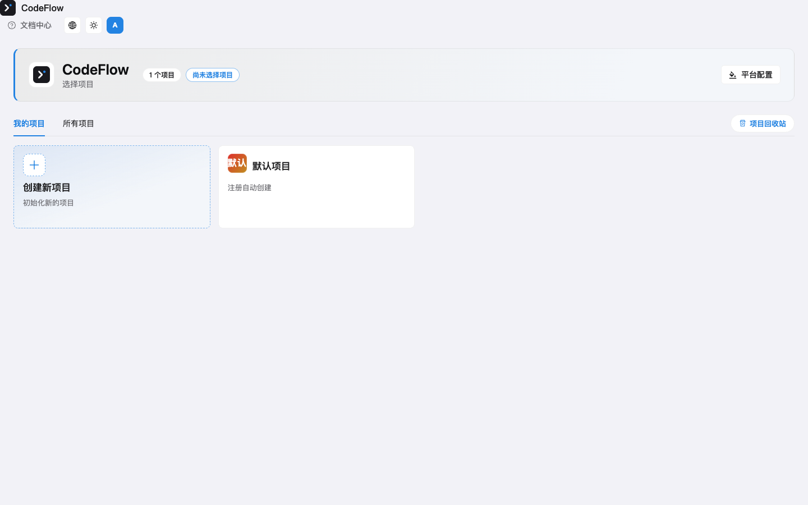
图 2-2　项目选择页(登录后第一站;右上「平台配置」直达平台级配置)

### 2.2 界面骨架

| 区域 | 说明 |
|---|---|
| 顶栏 | 品牌 → 当前页面路径 → 搜索框(⌘K 命令面板)→ 项目切换 → 通知 → 外观切换 → 用户菜单 |
| 左侧导航树 | 顶部独立一项 **项目总览**;下面五组:**需求交付**(需求录入/交付流程/运行记录)、**分析**(交付分析/操作审计)、**执行与自动化**(定时任务/运行节点/AI 数字员工)、**配置资产**(代码仓库/AI 记忆/AI 技能/状态流转)、**项目设置**(外部连接/成员管理/配置备份/环境变量/回收站);树尾还有 **文档中心**(F1)、**设置**(⌘,)、**关于平台** |
| 内容区 | 各功能页;列表类页面为「墨色横幅 + 一句话说明 + 工具栏 + 内容面板」的统一骨架 |
| 底部状态栏 | 命令面板入口 / 当前项目 / 语言切换 / 明暗外观切换 / 平台版本 |

### 2.3 菜单导航

十七个入口分成五组(顶部「项目总览」与树尾三个入口未列入下表)。下表给出每个菜单的用途与对应章节,可作为全书的索引:

::: group
| 分组 | 菜单 | 用途 | 章节 |
|---|---|---|---|
| 总览 | 项目总览 | 新增多少、交付多少、还压着什么(KPI 八卡) | 第 4 章 |
| 需求交付 | 需求录入 | 录入需求与缺陷,发起澄清、派发交付、跟踪结果 | 第 5 章 |
| 需求交付 | 交付流程 | 定义项目的交付流程模板与步骤完成门 | 第 9 章 |
| 需求交付 | 运行记录 | 全部派发执行历史与单次执行详情 | 17.1 |
| 分析 | 交付分析 | 实时看板 / 人机协作 / 工作项交付 / 阶段耗时 | 17.2 |
| 分析 | 操作审计 | 全部敏感操作留痕,可筛选、可导出 | 17.3 |
| 执行与自动化 | 运行节点 | 执行环境注册、启动命令、状态与容量 | 第 10 章 |
| 执行与自动化 | 定时任务 | 按计划自动派发数字员工,含定时需求与运行记录 | 第 18 章 |
| 执行与自动化 | AI 数字员工 | 可执行角色定义、版本审核 | 8.1、8.2 |
| 配置资产 | 代码仓库 | 仓库绑定与仓库关系图 | 11.1、11.2 |
| 配置资产 | AI 记忆 | 长期记忆的查看与清理 | 17.3 |
| 配置资产 | AI 技能 | 挂到数字员工上的能力包 | 11.3 |
| 配置资产 | 状态流转 | 按需求类型分域的状态机模板 | 16.1 |
| 项目设置 | 外部连接 | 禅道 / TAPD 绑定、消息渠道 | 第 12~14 章 |
| 项目设置 | 成员管理 | 成员、角色与访问申请 | 16.3 |
| 项目设置 | 配置备份 | 一键备份与恢复项目配置 | 16.1 |
| 项目设置 | 环境变量 | 项目级环境变量,值默认脱敏 | 16.1 |
| 项目设置 | 回收站 | 已删需求与项目,可恢复 | 5.5 |
:::

### 2.4 主题工作台与个性化

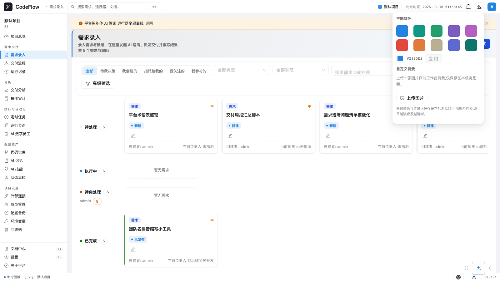
图 2-3　主题工作台(预设色板 + 自定义色 + 自定义背景)

- **主题颜色**:10 个精选预设,或用取色器自定义;「跟随平台」恢复品牌色。切换即时生效,链接 / 高亮 / 选中态 / 图表全部跟随;
- **自定义背景**:上传本地图片作为工作台壁纸(前端自动压缩,超 1.2MB 拒绝),「背景遮罩」滑杆实时调节清晰度与可读性;仅保存在本机浏览器,不随账号漫游;
- 明暗模式(☀/🌙/🖥)在底部状态栏的「切换外观」按钮,与主题色独立组合。

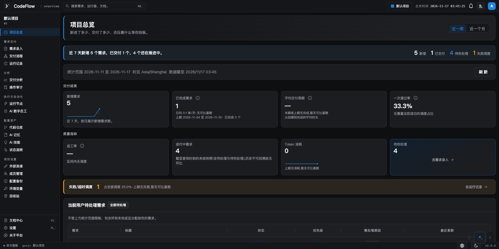
图 2-4　暗色外观下的项目总览(与图 4-1 同一页面)

---

# 第二部分 · 使用指南

> EN:PART TWO
> 摘要:从注册到日常使用的主线路径:快速开始 → 需求主线(录入 / 澄清 / 跟踪)→ 执行资产(数字员工 / 交付流程 / 运行节点)→ 外部连接与项目设置。按顺序读完即可独立使用平台。

## 3. 快速开始:从注册到跑通第一条需求

> EN:GETTING STARTED
> 摘要:注册即管理员 → 4 步引导跑起运行节点 → 建第一条需求走通全链路。先跑通一条,再并行多条。

### 3.1 四步引导页

第一次登录并选择项目后,系统自动进入 4 步引导页(`/onboarding`,可随时跳过,也能从「关于平台」页重放):

| 步 | 内容 | 要点 |
|---|---|---|
| 1 认识模型 | 「需求进 · 交付出」的交付流程示意 | 记住关键认知:AI 数字员工由你部署的**运行节点**驱动,不在浏览器里 |
| 2 跑起运行节点(必做) | 可复制的启动代码块 + 实时探测 | 在「运行节点」页注册拿到 ID/Token → 机器上配 env → 启动 daemon;本页每 3 秒自动探测,**状态变绿即可继续** |
| 3 认识预置阵容 | 开发与评审编队、AI 数字员工、交付流程模板 | 开箱可用;自定义编队 / AI 生成流程 / 登记仓库为可选 |
| 4 打通需求源 | 禅道绑定三要素 + 测试连接 | 可选:跳过也能直接「新建需求」体验交付 |

- 引导状态保存在浏览器本地;换浏览器或清除存储后会再次出现,点「完成」即不再提示。
- 未配置运行节点时点「跳过引导」会二次确认(防止新手漏掉关键一步)。

### 3.2 建议的上手节奏

::: callout
先跑通一条 | 先跑通**一条**需求(澄清 → 派发 → 验收),再给 AI 数字员工配更多运行节点,然后开始并行两条,最后把踩过的坑沉淀进 AI 技能和 AI 记忆。不要一上来就配四个角色。
:::

::: stats
1 | 条 | 第一条需求 | 先跑通一条,不要并行
2 | 条 | 第二批 | 稳定后再并行,观察排队与容量
4 | 步 | 交付流程 | 分析与分支准备 → 编码与测试 → 验证与交付 → 交接评审
24 | 轮 | 单次执行轮次上限 | 模型调用轮次不够时可在运行节点 env 调整
:::

## 4. 项目与项目总览

> EN:PROJECT OVERVIEW
> 摘要:项目是数据归属的边界;项目总览回答"新增了多少、交付了多少、还压着什么"。

### 4.1 项目是数据的边界

- 登录后先选**项目**;需求、编队、交付流程、运行节点、外部连接等所有业务数据都归属某个项目。
- 一个用户可属于多个项目,顶部项目切换器可随时切换;「我的项目 / 所有项目」页签过滤列表;右上「平台配置」直达平台级配置;项目删除进「项目回收站」,可恢复。

### 4.2 项目总览的八张卡

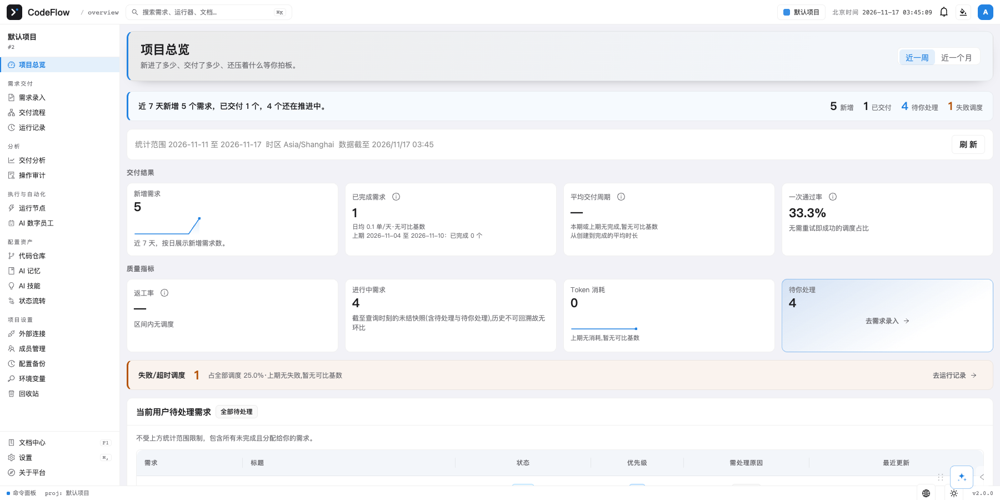
图 4-1　项目总览——「交付结果 + 质量指标」两排 KPI 卡,同构等高

项目总览(左树第一项)KPI 卡两排四列、同构等高:

::: stats
8 | 张 | KPI 卡 | 上排交付结果,下排质量指标,同构等高
7 | 天 | 默认统计窗口 | 右上「近一周 / 近一个月」可切换
1 | 条 | 结论条 | 页顶一句话回答"近 7 天新增多少、交付多少、还压着什么"
2 | 张 | 下方清单 | 当前用户待处理 + 近期新增的需求
:::

- **上排「交付结果」**:新增需求 / 已完成需求 / 平均交付周期 / 一次通过率;
- **下排「质量指标」**:返工率 / 进行中需求 / Token 消耗 / 待你处理;
- 每卡为「标题 + 大数字 + 至多两行说明」,趋势卡带迷你折线,口径说明收进标题旁的 ⓘ 悬浮;
- 页顶一句话结论条直接回答「近 7 天新增多少、交付多少、还压着什么」;右上「近一周 / 近一个月」切换统计范围。

### 4.3 失败与超时调度

项目总览下方列出**失败与超时调度**:派发因模型配额、基础设施中断或完成门未达标而失败的记录,直接给出「重试」入口,不必先去运行记录里翻。调度项按失败原因归类,便于判断是模型侧、仓库权限侧还是流程配置侧的问题。

⚠ 删除项目会级联影响其下需求与配置,属高危操作,请先在「配置备份 / 回收站」确认后再执行。

## 5. 需求:从录入到交付的主线

> EN:REQUIREMENT LIFECYCLE
> 摘要:需求是全平台的中心对象:录入 → 澄清 → 启动交付 → 跟踪 → 验收,每一步在详情页都有归属。

> 需求录入页的定位一句话:录入需求与缺陷,在这里发起 AI 澄清、派发交付并跟踪结果。

### 5.1 需求录入看板

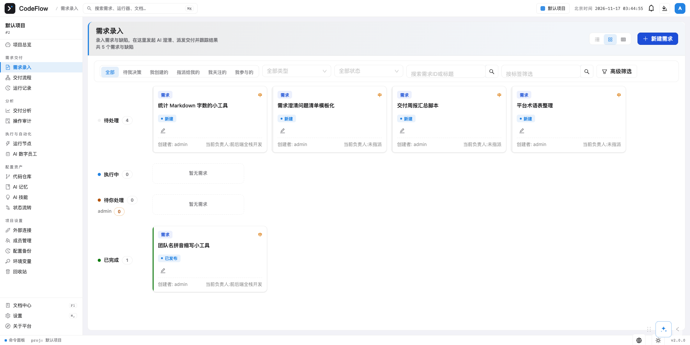
图 5-1　需求看板(状态分列卡片式)

| 元素 | 说明 |
|---|---|
| 范围页签 | 全部 / 待我决策 / 我创建的 / 指派给我的 / 我关注的 / 我参与的 |
| 类型/状态筛选 | 按需求类型(需求/缺陷)与状态节点过滤 |
| 搜索框 | 按需求 ID 或标题搜索 |
| 标签筛选 / 高级筛选 | 组合条件;高级筛选支持优先级、创建者等更多维度 |
| 卡片 | 类型、状态、优先级、标题、创建者、当前处理人;**外部来源需求带「来自 + 来源平台名」链接**(如「来自 ZenTao」),点击直达禅道原始对象 |
| 视图切换 | 看板 / 列表 / 表格三种视图 |

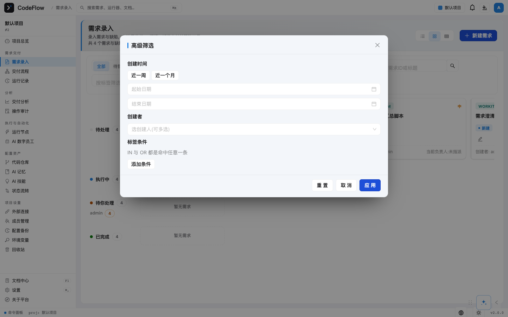
图 5-2　需求高级筛选

### 5.2 新建需求

入口:需求页右上角「+ 新建需求」。

必填:**类型**(需求/缺陷)、**标题**、**需求/设计文档**(Markdown);可选:优先级。
创建后进入需求详情页。需求支持上传需求/设计上下文附件(任意类型,单个 5MB、总共 20MB,可粘贴截图)。

### 5.3 需求详情


图 5-3　需求详情(以新建状态的需求为例;元信息条 / 动作区 / 需求文档 / 附件 / 评论时间线)

| 元素 | 说明 |
|---|---|
| 元信息条 | 类型 / 状态 / 优先级 / 创建者 / 处理人 / 标签,状态与标签可直接改 |
| 启动交付 | 指派 AI 数字员工并按交付流程启动自动交付(见 5.4) |
| 交给同事处理 / 流转到其他状态 | 需求交接给同事人工接棒;状态按模板流转 |
| 需求/设计文档 | Markdown 编辑;外部来源需求只读并显示「由外部需求维护」 |
| 评论 & 时间线 | 全部沟通与系统事件(创建/流转/派发/交接/回写)按时间倒序 |
| 右栏 | AI 需求澄清(第 6 章)、任务信息、交付进度跟踪(第 7 章) |
| 分享 | 生成只读分享链接(产物页无需登录可看) |

外部来源需求(禅道拉取)在标题下显示来源标识,删除受保护——**必须回禅道处理,平台侧不可删**。

下面是一条真实交付中的需求:左侧是需求正文,右栏是实时交付进度(本图与图 5-4 取自同一次真实交付,四步全部通过):

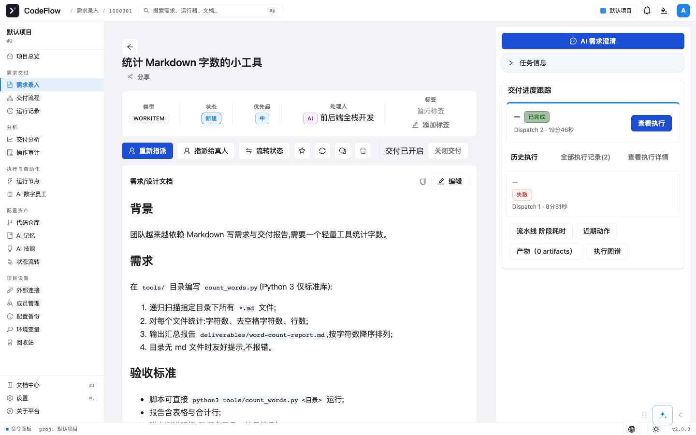
图 5-4　真实交付中的需求(右栏实时交付面板 + 交付产物)

发表评论有即时反馈(左下角「评论已发送」提示):

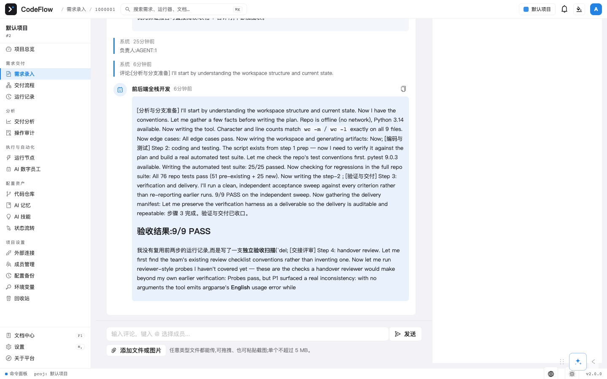
图 5-5　发表评论:AI 数字员工即时回复验收结果(评论与时间线按序留痕)

### 5.4 启动交付(把活交给 AI 数字员工)

::: steps
点「启动交付」 | 右栏进入「AI 需求澄清」向导,选择编队与 AI 数字员工。
确认后平台创建派发 | 需求进入「执行中」,生成 Dispatch ID。
运行节点接手 | 在线则立即开跑;离线则排队等待并显示原因(第 7 章)。
:::

交付开启后,需求右上出现「关闭交付」;关闭后不再接受新的自动派发,评论区 @ AI 数字员工也会被拦截提示。

### 5.5 删除与回收站

删除需求进回收站(左树「项目设置 → 回收站」),可恢复;外部来源需求不可删除。

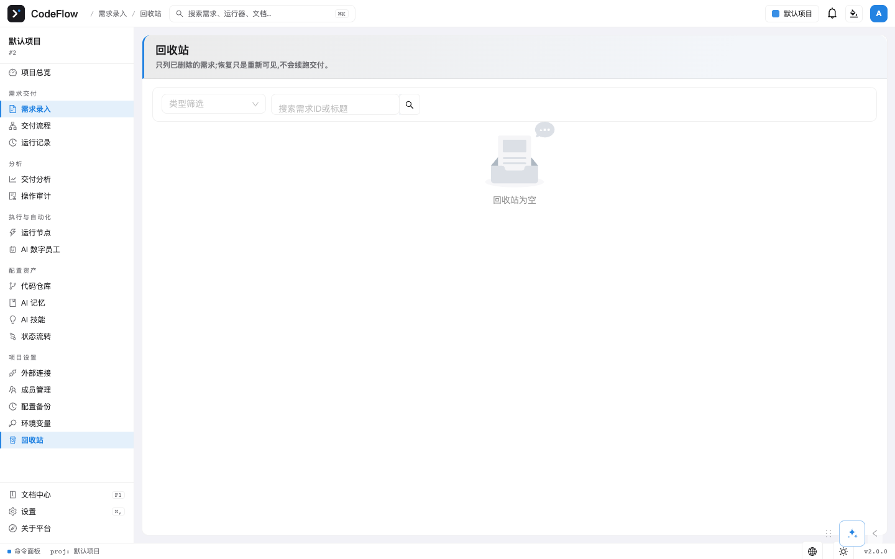
图 5-6　需求回收站

## 6. AI 需求澄清对话

> EN:AI CLARIFICATION
> 摘要:启动交付前先对齐验收标准——澄清对话是返工率的第一道闸。

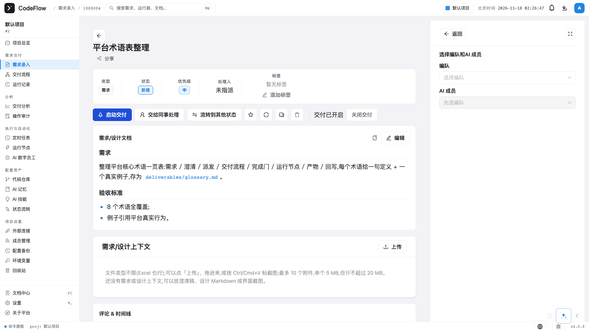
图 6-1　AI 需求澄清向导(第一步:按编队 → AI 数字员工两级选择交付主体)

### 6.1 为什么先澄清

::: stats
19 | 个 | 澄清问题 | 真实交付中单轮反问的上限
4 | 类 | 澄清维度 | 边界 · 技术栈 · 验收标准 · 回滚策略
2 | 份 | 产出文档 | spec.md 与 plan.md 直接入库
1 | 轮 | 澄清时机 | 开工之前,不是开发一半
:::

这 19 个问题如果拖到开发一半才冒出来,每一个都是一次返工。澄清的价值不在于"问得多",而在于**把没说清的变成说清的**:哪些不归这次交付管、用什么技术栈、"做完了"怎么判、失败怎么退。

### 6.2 澄清面板怎么用

::: steps
进入澄清 | 右栏点「AI 需求澄清」,或在评论区 @AI数字员工 直接提问。
回答问题 | 按四类维度逐条回答:边界 / 技术栈 / 验收标准 / 回滚策略。
生成文档 | 回答完成后,平台把结论写成 spec.md 与 plan.md 存入附件。
随交付注入 | 下一次派发自动带上这两份文档,不用再口头交代一遍。
:::

- **启动交付前**:右栏「AI 需求澄清」进入向导,按编队 → AI 数字员工两级选择交付主体;
- **交付中**:直接在评论区 `@AI数字员工` 提问,AI 数字员工经平台 MCP **实时读取需求内容**后作答与追问,形成澄清会话;
- AI 数字员工的每次回复都带用量(模型/Token)与耗时,可在时间线追溯。

**发送方式可切换**:输入框旁的入口标明当前模式——默认 Shift+回车 发送(回车换行),可切为回车发送;切换会写入个人偏好,重新登录后保持。回复进行中输入框会禁用并显示动态指示,可随时「终止响应」。

⚠ 需求描述写不清是交付返工的最大来源。建议启动交付前先用澄清对话把验收标准对齐——这比事后返工便宜得多。

### 6.3 澄清结论去哪了

澄清不是聊天记录,而是交付输入:结论落成 spec.md 与 plan.md 存入需求附件,并在派发时随上下文注入执行环境;时间线里保留每一轮问答与用量,可回看"当时为什么这么定"。需要人工把关时,把澄清意见留在评论区,下一轮派发会读到它继续(见 7.5)。

## 7. 交付进度跟踪:看 AI 数字员工干活

> EN:DELIVERY TRACKING
> 摘要:执行中的每一步都落在需求详情里:卡在哪、为什么失败、产物在哪,失败可一键重试。


图 7-1　交付进度跟踪面板(当前派发 + 历史执行)

### 7.1 当前派发与历史执行

| 元素 | 说明 |
|---|---|
| 当前派发卡 | AI 数字员工 / 流程步骤 / 状态(含失败红标)/ Dispatch ID / 耗时 / 运行节点名 |
| 查看执行 | 打开该派发的实时执行视图(终端/日志) |
| 重试 | 失败后原样重发 |
| 历史执行 | 全部执行记录(含交接产生的下游派发),可看执行详情 |
| 控制记录 | 指派 / 暂停 / 恢复 / 停止等人工操作留痕 |
| 交付流程 阶段耗时 / 近期动作 | 每一步耗时与最新进展 |
| 产物 | AI 数字员工产出的文件(deliverables),可直接下载 |
| 执行图谱 | 步骤与交接的图形化视图 |

**排队原因会明说**:运行节点不在线时派发不会空转,而是按指数退避等待,面板直接显示原因(如「等运行器上线」「等待运行器容量」)与已等时长;运行节点上线后自动唤醒,无需人工重发。

### 7.2 四步交付流程与完成门

::: steps
分析与分支准备 | 读懂需求与代码库,准备分支与实施方案。
编码与测试 | 按澄清结论实现,并跑通测试。
验证与交付 | 部署到目标环境并验证,产出交付物。
交接评审 | 汇总结论与证据,交给人判断是否验收。
:::

每一步都有**完成门**:达标才往下走,不达标停在当前步并说明原因。完成门是流程模板里定义的(见第 9 章),验收标准越明确,完成门越可判定。

### 7.3 失败重试与产物归档

**失败了就地重试**:某次派发失败(模型配额、基础设施中断等)时,面板给出「重试」按钮,原样重发一次并记为新 attempt,前几轮执行记录全部保留可查——下图是一次真实交付:第一轮因轮次上限失败(红标),重发的新执行接续跑完四步并交付:


图 7-2　失败派发的重试:历史执行里前一轮失败(红标),重发的新执行接续跑完全部四步并交付

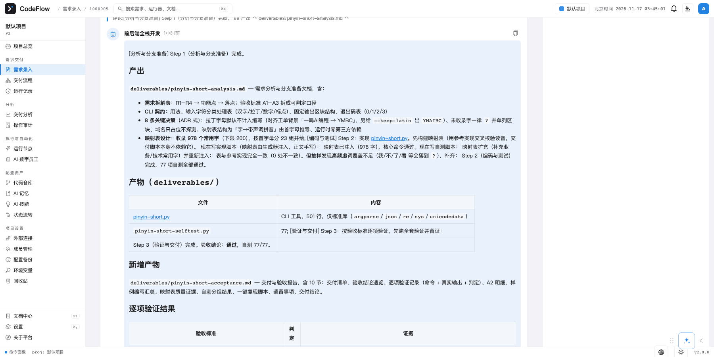
图 7-3　交付产物入库:本次交付归档 8 个文件(过程文档/工具脚本/汇总报告),面板内可滚动查看全部并下载

### 7.4 运行日志与实时终端

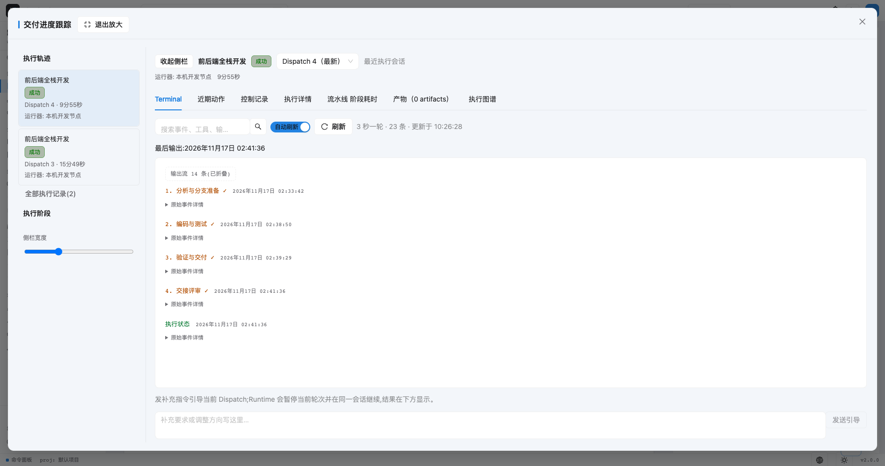
图 7-4　运行轨迹与实时终端:四步交付流程按序带 ✓、等宽时间戳、输出流自动折叠,交付过程可回看

「查看执行」进入执行档案:左侧是四步交付流程与步骤日志,右侧是实时终端输出。日志按步骤折叠,长输出自动收起,时间戳等宽对齐;执行档案同时给出结果摘要——交付结论、产物清单与关键指标都在这一页,不用再翻聊天记录。

### 7.5 人工介入:解开僵局的标准动作

⚠ **人工介入**:若 AI 数字员工卡在需要判断的地方(如评审不通过但环境无法满足某项通过条件),在需求评论区留下澄清意见并说明判定口径,下一轮派发会读到这条意见继续——这是解开僵局的标准动作,不用改配置、不用重建派发。

## 8. AI 数字员工与编队

> EN:AI WORKERS & SQUADS
> 摘要:AI 数字员工是绑定客户端与模型的可执行角色;编队是"谁 + 什么角色 + 哪条交付流程"的交付阵型。

入口:左侧导航 → AI 数字员工。

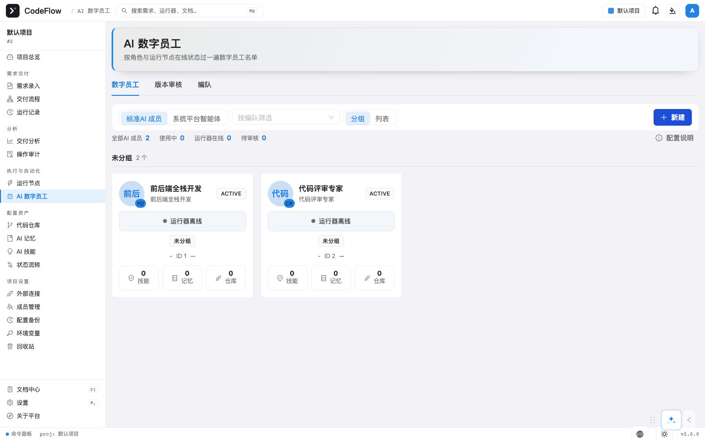
图 8-1　AI 数字员工管理(数字员工 / 版本审核 / 编队三个页签)

### 8.1 AI 数字员工

一个可执行的角色(如"前后端全栈开发"),绑定**客户端类型**(Claude Code / Codex CLI / Cursor CLI / Gemini CLI / Qoder CLI 等)与**模型**。模型端点由运行节点侧的 `ANTHROPIC_BASE_URL` / `ANTHROPIC_AUTH_TOKEN` / `ANTHROPIC_MODEL` 决定,同一个数字员工可以配不同的客户端与模型组合。

### 8.2 版本审核

`/agents/reviews` 页:AI 数字员工配置的变更走版本化,提交后在此页审核,通过才进入上线流转——防止未评审的改动直接跑生产。评审不通过时按稳定问题清单返工,是数字员工的默认协作方式。

### 8.3 编队

多个 AI 数字员工 + 角色构成 + 关联交付流程组成交付阵型。启动交付时选的是编队,平台据此决定由谁、按什么流程干活。

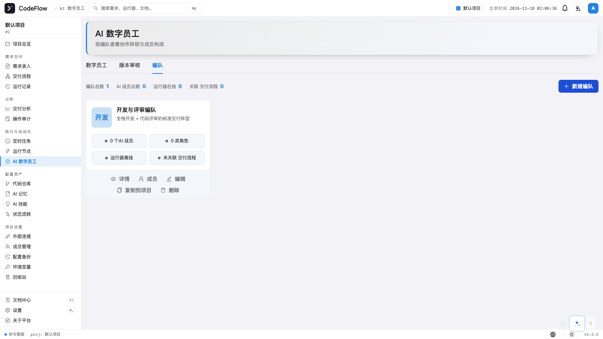
图 8-2　编队详情(数字员工阵容 / 角色构成 / 交付流程)

编队卡片的「1/2 在线」徽标 = 该编队当前在线的运行节点数 / 运行节点总数(离线节点上的派发会排队等待)。

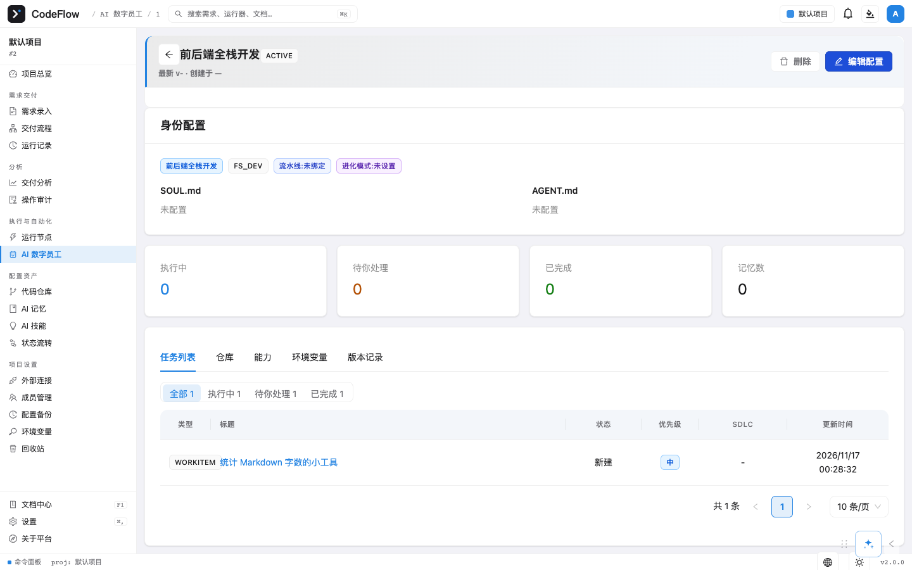
图 8-3　AI 数字员工详情

## 9. 交付流程(流程模板)

> EN:DELIVERY PLAYBOOK
> 摘要:每个项目定义自己的交付流程;启动交付时选的流程,决定 AI 按什么路径干活。

入口:左侧导航 → 交付流程,页面为「流程模板」列表(流程模版 / 模版间 / 编队工作流三个页签)。

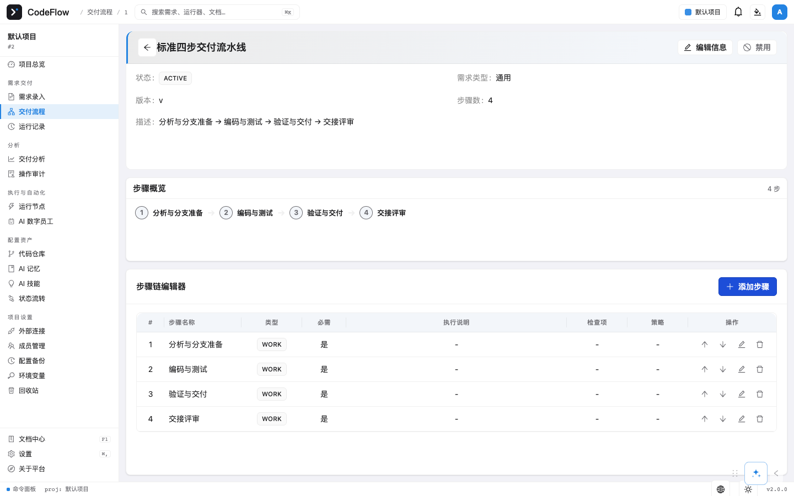
图 9-1　流程模板详情(步骤概览与逐步编辑;列表见「交付流程」页)

### 9.1 流程模版

一次交付的步骤序列(如:分析与分支准备 → 编码与测试 → 验证与交付 → 交接评审),每步含**目标、完成门、要求产物**。「详情」里可以逐步查看 / 编辑步骤定义。

### 9.2 模版间与编队工作流

| 元素 | 说明 |
|---|---|
| 模版间 | 模板之间的衔接(开发完成后接评审模板) |
| 编队工作流 | 编队视角的流程编排,按角色分配步骤 |
| 新建 | 手工按步骤定义建流程 |
| AI 生成 | 由 AI 按描述生成流程草案,再手工调整 |

需求启动交付时选择的交付流程,决定 AI 数字员工按什么路径干活。

## 10. 运行节点管理

> EN:RUNTIME EXECUTORS
> 摘要:真正干活的是运行节点——装在你自己的机器上,主动连回平台;代码在内网也没关系。

入口:左侧导航 → 运行节点。

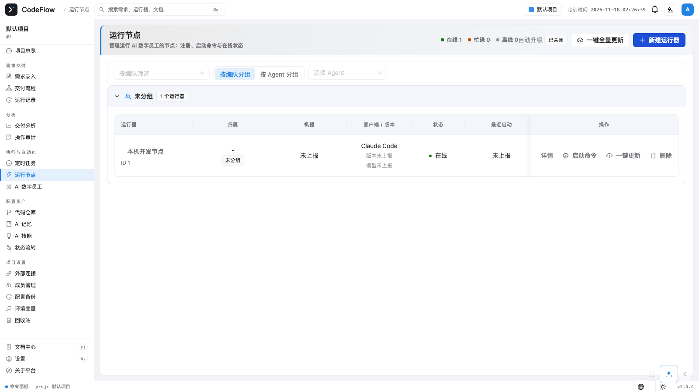
图 10-1　运行节点管理(按编队分组;在线/忙碌/离线一目了然)

### 10.1 运行节点是什么

运行节点是执行环境:它主动连回平台领取派发,在你自己的机器上跑 AI 数字员工。平台不需要访问你的机器——代码和被测系统可以全在内网。

新建运行节点时需选择:归属 AI 数字员工 / 客户端类型(六种卡片单选)/ 并发数 / 记忆模式;创建成功弹窗直接给出令牌与启动命令。

### 10.2 三种运行方式

::: compare
| 运行方式 | 行为 | 适用场景 |
| 前台运行 | 关掉终端即停止 | 调试,看实时输出 |
| 后台挂起 | nohup 挂起,进程崩溃不自愈 | 临时跑一次,能接受手动重启 |
| 系统服务 | install-service,崩溃自愈 + 开机自启 | **推荐**:长时间稳定交付 |
:::

::: callout
复制入口 | 启动命令弹窗与创建成功弹窗都按当前选中的运行方式出命令;复制后贴到运行节点机器执行即可。卸载系统服务用 `ymai-codeflow uninstall-service --executor-id <id>`。
:::

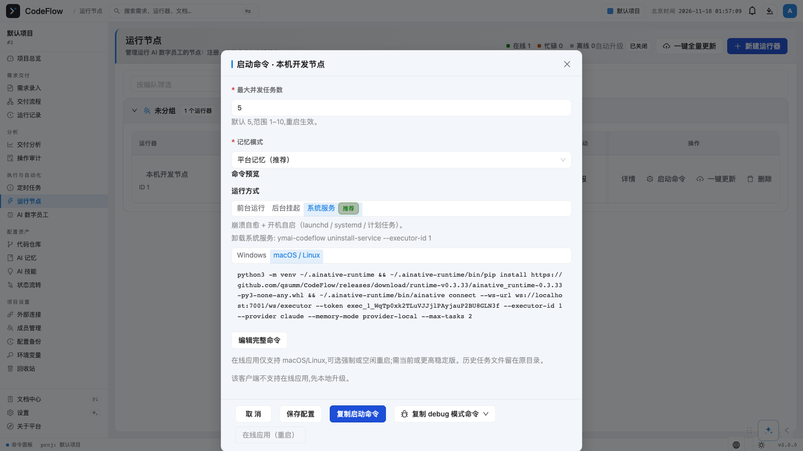
图 10-2　启动命令弹窗(运行方式切到「系统服务」,命令实时重生成)

### 10.3 状态、容量与分组

- **在线状态**:心跳判活 + 最近启动时间;离线的运行节点其排队派发会显示等待原因;
- **分组视图**:按编队 / 按 AI 数字员工分组;按编队筛选后看目标运行节点;
- **运行节点详情**:抽屉查看主机名 / IP / 版本 / 模型 / 最近启动 / 重启记录;
- **自动升级**:开启后运行节点版本落后自动升级;「一键全量更新」按编队批量升级到平台推荐版本。

### 10.4 运维红线

⚠ **同一个 executorId+token 同时只允许一个 daemon 实例**——后来者会把先来者顶下线。看到状态反复"在线/离线"抖动,先排查是否两个 daemon 用同一份 env 在跑。

运行节点侧安装与运行(注册、环境变量、接入任意 Anthropic 兼容模型端点)在「新建运行器」与启动命令弹窗里都有引导;守护化(开机自启 / 崩溃自愈)即上文「系统服务」运行方式。

## 11. 代码仓库与 AI 技能

> EN:REPOSITORIES & SKILLS
> 摘要:仓库是 AI 干活的代码仓,技能是挂到 AI 数字员工上的能力包。

### 11.1 代码仓库

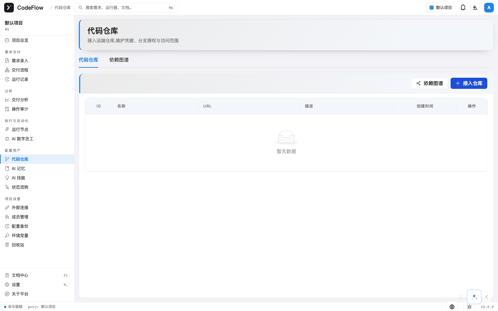
图 11-1　代码仓库管理

AI 数字员工干活的代码仓库,绑定后交付时代码会检出、修改、提交。

### 11.2 仓库关系图

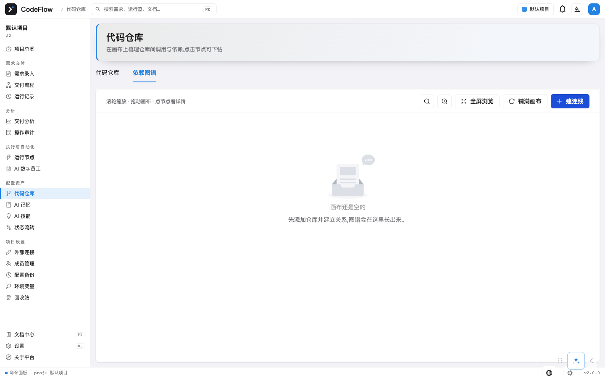
图 11-2　仓库关系图(依赖与调用关系可视化;添加仓库并建立关系后,画布在此呈现)

「代码仓库」页的「依赖图」页签可视化仓库之间的依赖与调用关系,滚轮缩放、拖动布局、点击查看详情。

### 11.3 AI 技能

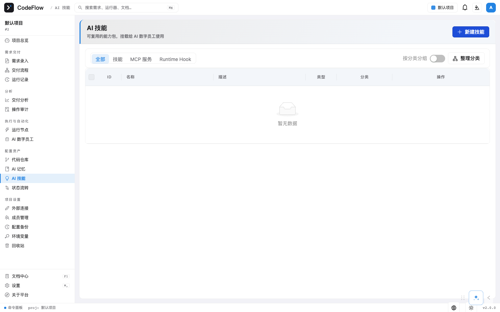
图 11-3　AI 技能管理

AI 技能是可挂到 AI 数字员工上的能力包(MCP 工具集、提示词、脚本),平台内置技能可直接启用,也支持上传自定义包。踩过的坑沉淀成技能,是第 3 章"上手节奏"的最后一步。

## 12. 外部连接:禅道闭环

> EN:ZENTAO INTEGRATION
> 摘要:三步建绑定,之后禅道 Bug/需求自动进平台、交付结论自动回写评论;状态由人在禅道侧确认。

入口:左侧导航 → 外部连接。当前支持 **禅道 ZenTao 18.10+**。

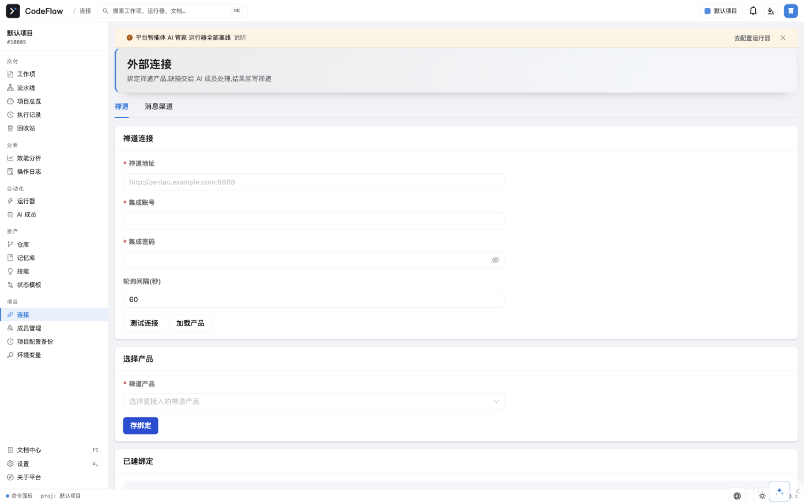
图 12-1　禅道连接配置

### 12.1 建绑定(三步)

::: steps
禅道连接 | 填禅道地址(如 `http://zentao.example.com:8888`)、集成账号、集成密码;点「测试连接」验证,通过后「加载产品」拉取产品列表。
选择产品 | 选要接入的禅道产品,设轮询间隔(默认 60 秒),保存绑定。
自动拉取 | 平台按间隔轮询该产品的 Bug 与需求,自动建为本地需求;重复拉取不会产生重复需求。
:::

### 12.2 闭环怎么转

```
禅道 Bug/需求 → 平台自动拉取入库 → 指派 AI 数字员工交付 → 交付结论回写禅道
```

- 交付结论经备注通道回写到禅道单据的评论,幂等 marker 防重复;
- ⚠ **平台不代改禅道单据状态**:单据的「已解决 / 关闭」由你在禅道侧确认后手工操作。修复是否真正闭环是人的判断,平台只负责把交付结论与证据带过去;
- 身份映射:禅道账号在平台内显示为外部用户(带来源标识);
- 绑定级状态映射可配(默认:active→待处理、resolved→待验证、closed→已完成),用于把禅道状态同步成平台需求的状态,不反向改写禅道。

⚠ 平台侧需求流转完成后,禅道单据状态可能仍停在旧值——这是设计如此(见上一条),不是同步失败。

## 13. 外部连接:TAPD(VIP 专享)

> EN:TAPD INTEGRATION
> 摘要:VIP 用户专享能力。与禅道同构的四步接入:TAPD 项目绑定 → 自动拉取 → 交付 → 结论写回评论;结果未知时不盲目重发,读回确认。

::: callout
VIP 用户专享 | TAPD 集成是 **VIP 版本**的能力,需开通后使用;禅道集成对所有版本开放。若你的「外部连接」页看不到 TAPD 页签,说明当前账号未开通。
:::

入口:左侧导航 → 外部连接 → **TAPD** 页签。除禅道外,平台还能从 TAPD 拉取需求与缺陷,并把交付结论写回原单据。

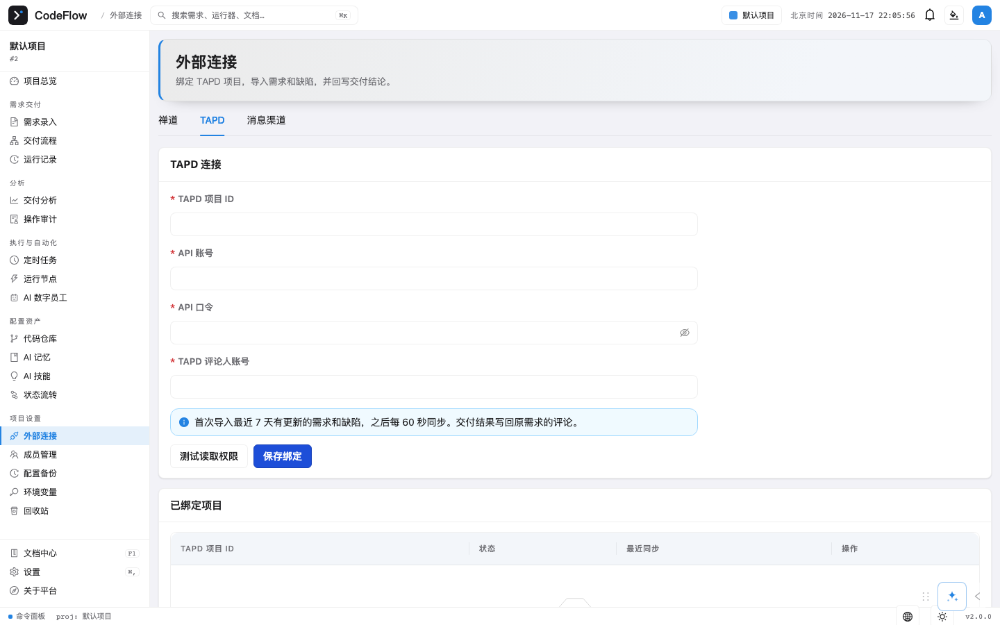
图 13-1　TAPD 连接配置

### 13.1 建绑定(四步)

::: steps
填连接信息 | TAPD 项目 ID(工作区 ID,纯数字)、API 账号、API 口令、TAPD 评论人账号(交付备注的署名,建议用专用机器人账号)。
测试读取权限 | 点「测试读取权限」,平台用该凭据各拉一条需求与一条缺陷,验证鉴权、项目归属与字段格式。
保存绑定 | 保存后平台开始按 60 秒轮询该项目的需求与缺陷,自动建为本地需求。
随时手动同步 | 「已绑定项目」表里点「立即同步」可立刻拉一轮;「暂停」用于临时停止轮询,恢复后接着增量拉取。
:::

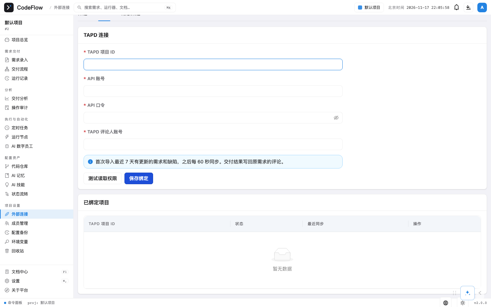
图 13-2　已绑定项目(未绑定时的空态;绑定成功后这里列出项目 ID、状态与最近同步时间)

### 13.2 同步进来的东西长什么样

- **需求(Story)与缺陷(Bug)一起进**:在需求里类型分别标 `REQ` 与 `BUG`,来源标 `TAPD`,标题下可直达 TAPD 原单据;
- **外部 ID 形态** `{项目 ID}:{story|bug}:{单据 ID}`,例 `1:bug:1010201`;同一单据重复拉取不会产生重复需求,只会刷新标题、正文、类型与优先级;
- **优先级映射**:high / urgent → 1,medium / middle / normal → 2,low → 3;
- **时间窗口**:首次拉取最近 7 天内有更新的单据,之后按轮询增量拉取;
- **正文以 TAPD 为准**:平台只把 TAPD 的 HTML 描述转成纯文本展示,不反向改写 TAPD 内容。

### 13.3 交付结论怎么回写

```
TAPD 需求/缺陷 → 平台自动拉取入库 → 指派 AI 数字员工交付 → 交付结论写回 TAPD 评论
```

- 交付完成后,运行节点把交付备注回写到**原单据的评论**(需求走 `entry_type=stories`、缺陷走 `entry_type=bug`,内容为 HTML,署名为上面填的评论人账号);
- 每条回写带唯一 marker,重复回写不会产生重复评论;
- 若 TAPD 侧返回 5xx(结果未知,可能已入库),平台**不会盲目重发**,而是把这次回写挂起,随后按 marker 回读评论确认是否已落地,确认后才置为完成;
- ⚠ 与禅道一致:平台只写评论,**不改单据状态**,关闭/已解决仍由你在 TAPD 侧确认。

### 13.4 部署前提

TAPD 的 API 口令以密文存放,平台需要一把凭据加密主密钥:

```bash
export AINATIVE_SECRET_MASTER_KEY=$(openssl rand -base64 32)
```

- 未配置时平台照常启动,只有保存绑定 / 同步 / 回写时报错,并提示该配哪个环境变量;
- 主密钥多节点必须一致;更换主密钥后,已保存的绑定需要重新保存一次。

## 14. 消息渠道(钉钉/飞书)

> EN:NOTIFICATION CHANNELS
> 摘要:绑定群机器人后,派发进展、交接、评审结论自动推群;平台级选中渠道决定通知设置里显示哪个 IM 列。

入口:左树「外部连接」,或平台配置 → 协作通知。

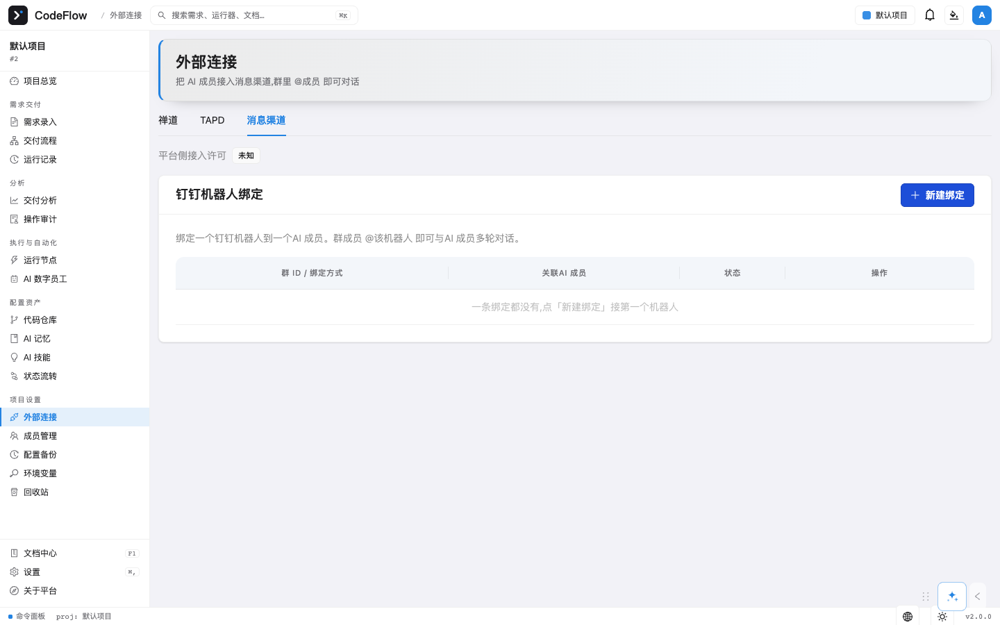
图 14-1　消息渠道(外部连接页)

### 14.1 渠道绑定

- 绑定钉钉 / 飞书群机器人后,派发进展、交接、评审结论等事件可推送到群;
- 支持项目机器人配置;渠道绑定是项目级的。

### 14.2 通知设置里的 IM 列

平台级选中渠道(平台配置 → 协作通知 → 选择钉钉/飞书)决定「通知设置」里显示哪个 IM 列:选中飞书后,每类事件可独立开关「站内 / 飞书」;启用飞书需先填入飞书开放平台应用的 appKey / appSecret。

## 15. 个人设置与 MCP 令牌

> EN:PERSONAL SETTINGS & MCP
> 摘要:一枚 MCP 令牌,让 Claude Code / Cursor 在终端里直接操作平台;令牌即身份,泄露即吊销。

入口:右上角头像 → 个人设置。页签:基本信息 / IM 工号 / 企业身份 / **MCP 令牌** / 修改密码 / 账号注销。

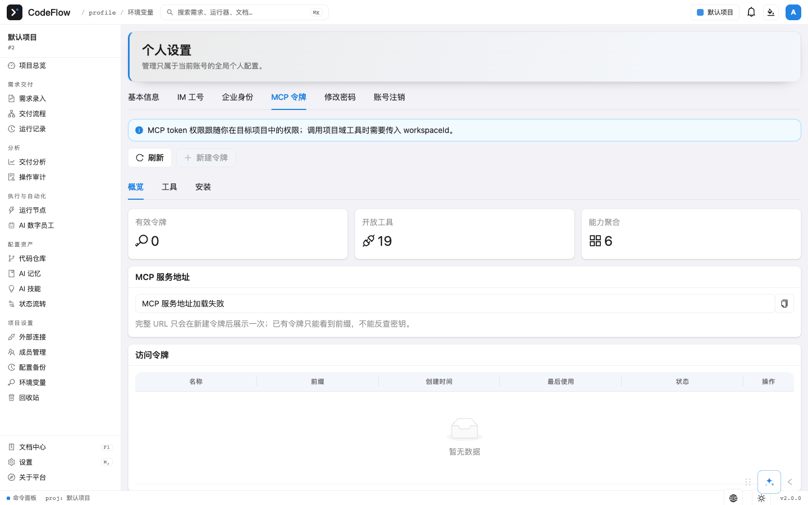
图 15-1　个人设置 → MCP 令牌

| 元素 | 说明 |
|---|---|
| MCP 服务地址 | `http://<平台>/api/mcp/<MCP_TOKEN>/`,建令牌时**完整 URL 只展示一次** |
| 开放工具 / 能力聚合 | 当前 MCP 面暴露的工具数与能力数 |
| 访问令牌 | 令牌列表:名称 / 前缀 / 创建时间 / 最后使用 / 状态 |

**怎么用**:把 MCP 地址配到你的 Claude Code / Cursor 等 CLI(`claude mcp add --transport http ainative <url>`),即可在终端里让 AI 直接操作平台:建需求、查需求、配置编队、启动交付等。令牌权限跟随你在目标项目内的权限。

⚠ 令牌即身份,不要提交进代码库;泄露后在列表里吊销即可,平台侧立即失效。

## 16. 项目设置与平台配置

> EN:PROJECT & PLATFORM SETTINGS
> 摘要:成员、状态机、环境变量、配置备份在「项目设置」组;品牌与平台级选项在右上「平台配置」;⌘, 打开设置弹窗。

### 16.1 项目设置组

| 页面 | 入口 | 说明 |
|---|---|---|
| 状态流转 | 左树 → 状态流转 | 需求状态机模板,按需求类型分域(需求 REQ / 任务 TASK / 缺陷 BUG 各自独立模板),定义状态与合法流转 |
| 环境变量 | 左树 → 环境变量 | 项目级环境变量,AI 数字员工执行时可读取(值默认脱敏展示) |
| 配置备份 | 左树 → 配置备份 | 一键备份当前项目的交付流程、AI 数字员工及版本、编队、仓库关系、AI 记忆、AI 技能等,可恢复 |
| 设置弹窗 | 左树底部「设置 ⌘,」 | 左类目 + 右内容:AI 配置 / 通知配置 / 系统配置 |

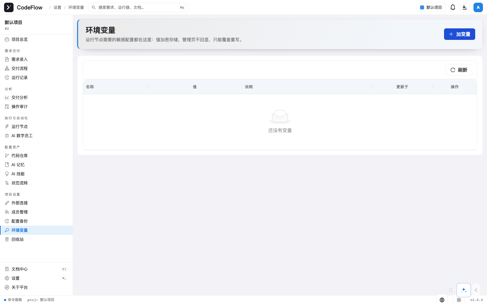
图 16-1　项目环境变量

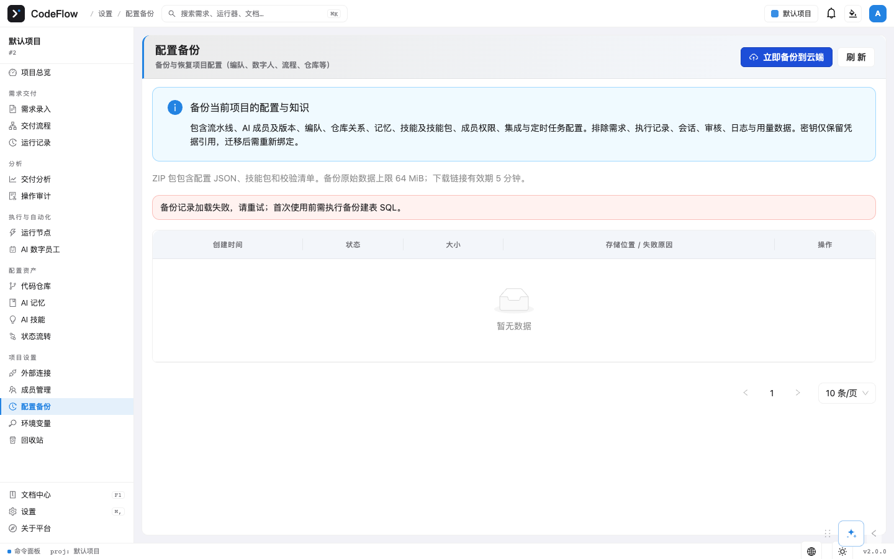
图 16-2　配置备份(一键备份,可恢复)

### 16.2 平台配置

| 页面 | 入口 | 说明 |
|---|---|---|
| 品牌配置 | 右上「平台配置」 | 平台名称 / Logo / 主题色 / 消息渠道,变更即时生效于全平台 |
| 协作通知 | 平台配置 → 协作通知 | 选择平台级 IM 渠道(钉钉 / 飞书),决定通知设置显示哪个 IM 列 |
| 文档与帮助 | 平台配置 → 文档 | 内置帮助中心与版本信息 |

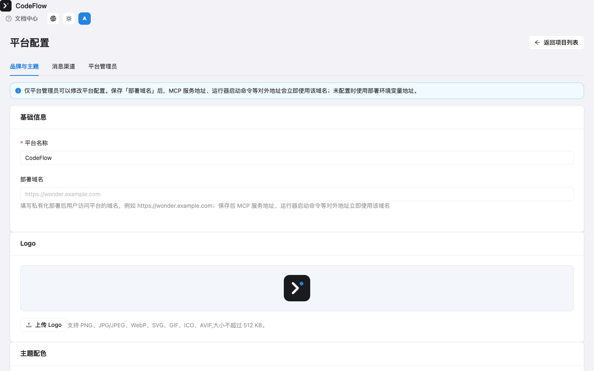
图 16-3　平台配置(品牌 / 消息渠道)

### 16.3 成员与角色

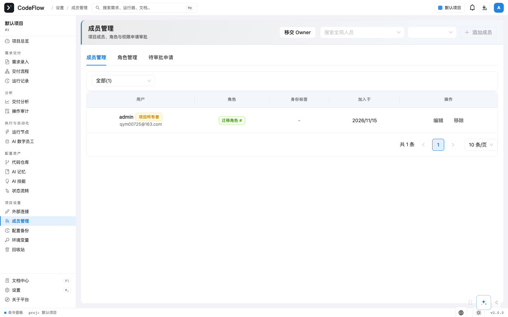
图 16-4　成员管理(成员 / 角色 / 申请)

成员管理页含三个页签:**成员**(邀请 / 移除 / 只读者 / Owner 移交)、**角色**(自定义角色与权限)、**申请**(待审批的访问申请)。移除成员前先确认其在项目内的派发与待办归属。

## 17. 运行记录、交付分析与操作审计

> EN:OBSERVABILITY & AUDIT
> 摘要:交付完不是结束:运行记录看每次执行,交付分析找瓶颈,操作审计留证据。

### 17.1 运行记录

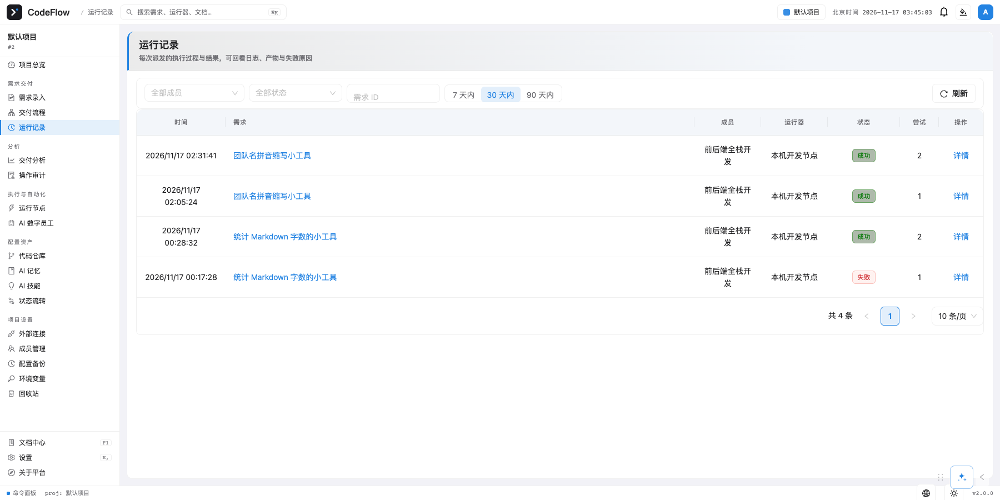
图 17-1　运行记录(全部派发执行历史)

全部派发的执行历史(状态 / 耗时 / 所属需求),点开看单次执行详情与日志。与需求详情里的"历史执行"是同一份数据的两个视角:这里看全局,那里看单条需求的上下文。

### 17.2 交付分析

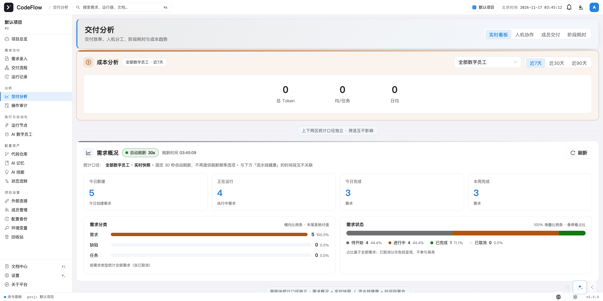
图 17-2　交付分析(实时看板:工作项概况 + 分类与状态占比)

四个页签:**实时看板**(工作项概况 + 分类与状态占比)、**人机协作**(人做了哪些判断、AI 做了哪些执行)、**工作项交付**(按类型与周期看交付表现)、**阶段耗时**(哪一步在拖)。成本分析卡按 Token 维度统计,用于回答"这批交付花了多少"。

### 17.3 操作审计与 AI 记忆

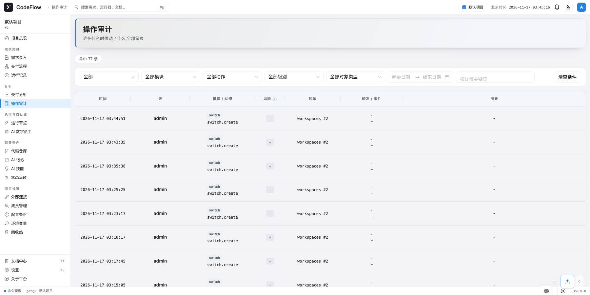
图 17-3　操作审计(全部敏感操作留痕)

- **操作审计**:全部敏感操作留痕(谁、何时、对什么、做了什么),支持按操作类型过滤;
- **AI 记忆**:AI 数字员工长期记忆的查看与清理;
- **通知**:站内通知中心,配合第 14 章的消息渠道做群播报。

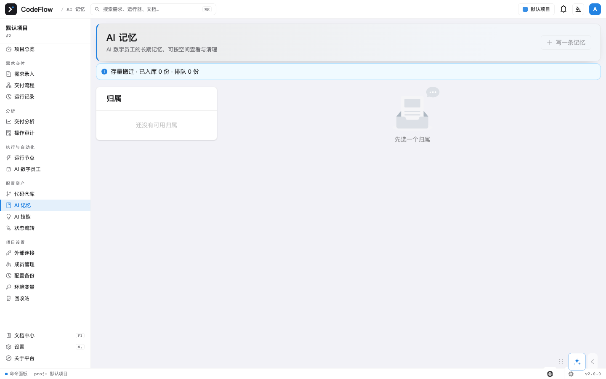
图 17-4　AI 记忆管理

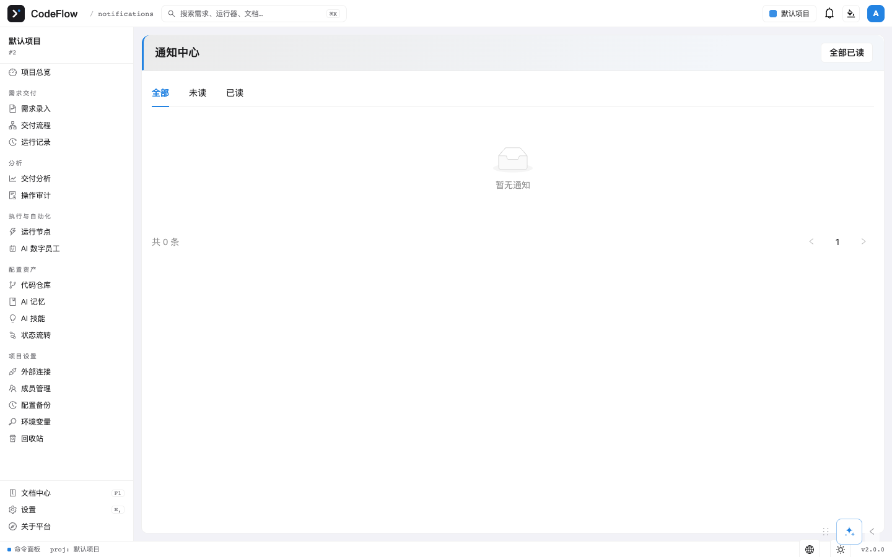
图 17-5　站内通知中心

## 18. 定时任务:让交付按计划自己发生

> EN:SCHEDULED TASKS
> 摘要:按 cron 计划自动派发数字员工;任务、运行记录与健康度一页看全。

入口:左侧导航 → 定时任务。页面分「定时任务」「定时需求」两个页签。

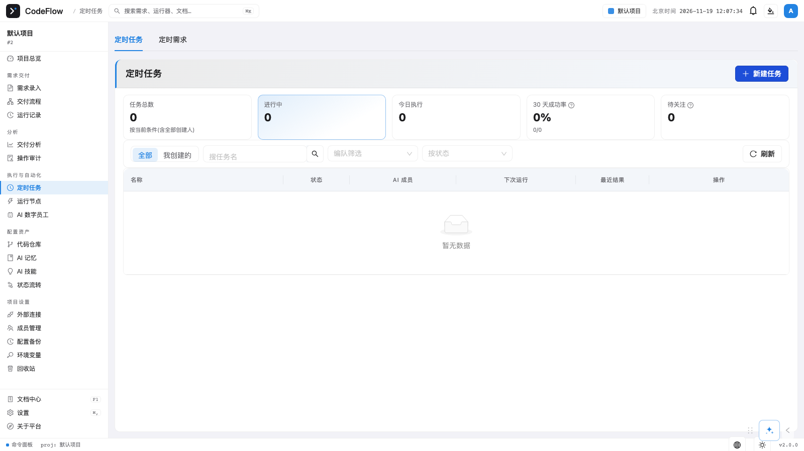
图 18-1　定时任务页(「定时任务 / 定时需求」双页签 + 全部 / 我创建的 范围切换 + 四张统计卡)

### 18.1 两个页签各看什么

| 页签 | 内容 |
|---|---|
| 定时任务 | 计划本体:名称、状态、起始数字员工、下次执行时间;可新建、编辑、暂停/启用、立即执行、删除 |
| 定时需求 | 由定时任务派生出的需求列表:每次触发生成一个需求,按计划持续产出 |

顶部还有「全部 / 我创建的」范围切换,只看你自己建的任务。

### 18.2 新建一个定时任务

::: steps
填基本信息 | 名称、指令(每次执行要做什么)、编队、起始数字员工、时区。
选触发方式 | 单次(指定时间)或 cron 周期;可附参考文档,让数字员工按文档口径执行。
定执行策略 | 会话重叠策略、错过执行策略(错过时补跑/跳过)、是否启用。
保存 | 保存后进入任务详情,显示「下次执行」时间。
:::

::: callout
权限 | 定时任务需要「读写」权限才能新建、暂停、立即执行;只读用户可以看列表与运行记录,但按钮不可用。
:::

### 18.3 任务详情与运行记录

详情页上半部是任务配置(编队、起始数字员工、调度表达式与会话重叠策略、错过执行策略),下半部是**运行记录**表:每次触发的运行编号、状态、触发方式、计划时间与实际结束时间。点运行编号进入运行详情。

运行详情可以看到这次执行的全过程:产物、评论、事件流、参与方、派生需求与交付进度,并支持取消与暂停。

::: stats
4 | 张 | 统计卡 | 任务总数 · 进行中 · 今日执行 · 30 天成功率
4 | 种 | 任务状态 | 启用中 · 已暂停 · 已跑完 · 已归档
1 | 次 | 立即执行 | 「立即执行」会立刻创建一次运行,不等计划时间
:::

---

## 19. 关于平台与文档中心

> EN:ABOUT THE PLATFORM
> 摘要:「交付 9 号线」地铁图把九段生命周期画成一条地铁线;文档中心内置分步图文。

入口:左树底部「关于平台」。

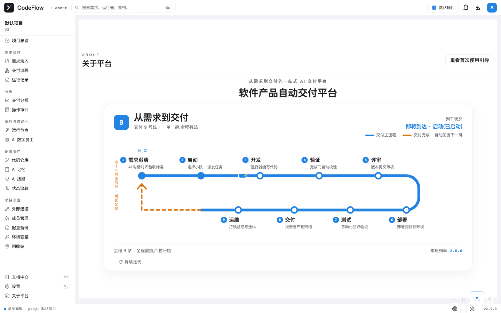
图 19-1　关于平台——「交付 9 号线」地铁图(主线路串九站,虚线回流)

### 18.1 交付 9 号线

- 九段(需求澄清 → 启动 → 开发 → 验证 → 评审 → 部署 → 测试 → 交付 → 运维)化作地铁 9 号线的九个站:主线路串起上 5 下 4 站,小列车沿线路巡航,驶过的站环逐个点亮;
- 右上「列车状态」随列车位置播报「即将到达 · 站名(阶段)」,并按阶段着色:进行中=主题蓝、已交付=绿、持续运营=青;
- 虚线自「运维」回流「需求澄清」始发站,表达「交付完成自动回流下一班」的闭环;
- 票务行展示当前部署版本(取自平台品牌配置);右上「重看首次使用引导」可重放第 3 章的引导页。

### 18.2 文档中心与 MCP 技能包

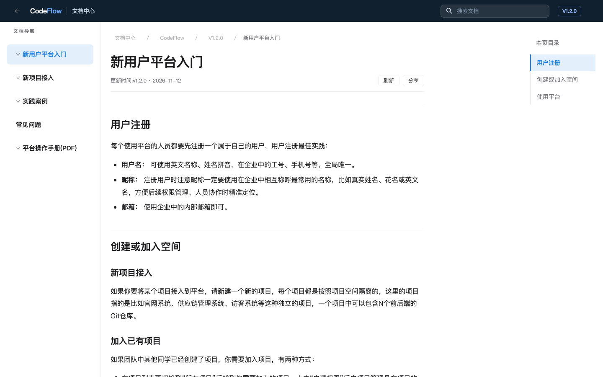
图 18-2　文档中心

- 左树底部「文档中心」(F1)直达;内容随版本内置,含分步图文与常见操作;
- 平台同时内置 `ainative` MCP 技能包(help/assets),供外部 CLI 客户端加载后获得平台操作指引。

## 20. 日常怎么用:推荐工作流

> EN:EVERYDAY WORKFLOWS
> 摘要:三条高频动线:禅道缺陷全自动修复回写、平台内需求交付、外部 CLI 操作平台。

### 20.1 场景 A:缺陷全自动修复与回写

::: steps
管理员一次性完成绑定 | 第 12 章的三步绑定,之后无需人工介入。
自动入库 | 禅道新 Bug 在 ≤ 轮询间隔内自动出现在需求看板(带「来自 ZenTao」来源链接)。
指派并启动交付 | 给需求指派编队并启动交付——之后不需要人守着。
按需回答 | 有澄清问题会停在「待你处理」,@ 回复即可。
自动回写 | 修复完成,交付结论自动回写禅道评论。
:::

### 20.2 场景 B:平台内需求 → 交付

::: steps
新建需求 | 把需求写清楚(或上传设计文档)。
澄清对齐 | 启动交付,选编队;对不清楚的点先用澄清对话对齐。
跟踪与验收 | 在交付进度跟踪里看执行,产物直接下载验收。
返工 | 验收不通过 → 评论返工意见 @AI数字员工,或重试派发。
:::

### 20.3 场景 C:外部 CLI 里操作平台

::: steps
建令牌 | 个人设置 → MCP 令牌 → 新建令牌,复制一次性完整 URL。
接入 CLI | `claude mcp add --transport http ainative <url>`。
直接说人话 | 在 Claude Code 里直接说"帮我建一个需求,标题是……"——AI 调平台 MCP 完成。
:::

### 20.4 三条实践建议

::: cards
✓ | 需求写清验收标准 | AI 数字员工按"完成门"自检,验收标准越明确返工越少。
⚠ | 别绕过平台改禅道状态 | 状态机映射是双向的,手工错位会卡同步。
◷ | 运行节点保持常驻 | 排队派发靠运行节点上线自动唤醒,运行节点越稳定交付越连贯。
:::

---

# 第三部分 · 参考

> EN:PART THREE
> 摘要:高频查阅区:边界声明(平台不做什么)、默认参数速查(一键对照)、FAQ、可选组件与修订记录。不必通读,用到即查。

## 21. 已知边界与使用须知

> EN:KNOWN LIMITS & NOTICES
> 摘要:这些是设计如此、或当前版本明确不做的事——遇到对应现象,先对照这里,再判断是不是故障。

### 21.1 平台行为边界(设计如此)

::: boundary
不代改外部单据状态 | 交付结论只回写禅道 / TAPD 评论,「已解决 / 关闭」仍需人工在外部系统按。修没修好是人的判断,工具代关单等于把验收责任扔给机器。
外部需求不可平台侧删除 | 禅道 / TAPD 拉来的需求删除受保护,必须回源头处理。源头数据以源头为准,平台侧删除会造成双端不一致。
不反向改写外部内容 | TAPD 正文只读展示;状态映射只把外部状态同步成平台状态,不反向改写。平台是消费方,不是外部系统的编辑器。
排队不空转 | 运行节点离线时派发按指数退避等待并显示原因,上线自动唤醒。宁可等得明白,不要假执行。
:::

### 21.2 能力范围边界(当前不做)

::: boundary
需求说不清,它救不了 | 澄清能把"没说清"问出来,但答案得在你心里。
不装环境 | 运行节点上缺 JDK、Maven、Node,任务就会失败;平台派活,不装环境。
不是无人值守 | 澄清要你参与,方案确认要你点头,验收要你看;省掉的是"盯着干活",不是"做判断"。
模型额度是真门槛 | 长任务中断在中间,重跑 Token 再花一遍;确定性任务建议用 Flash 模型,澄清和评审用旗舰模型。
:::

### 21.3 运维红线

- **主密钥多节点必须一致**(`AINATIVE_SECRET_MASTER_KEY`);更换后已保存的外部绑定需重新保存;
- **同一 executorId+token 只跑一个 daemon**,双实例会互相顶下线;
- **项目删除是级联高危操作**,先确认回收站与配置备份;
- **MCP 令牌即身份**,完整 URL 只展示一次,泄露立即吊销。

## 22. 默认参数速查

> EN:DEFAULT PARAMETERS
> 摘要:常用参数与默认值的一键对照,按"改哪里"排序。

### 22.1 模型与执行参数

::: spec
ANTHROPIC_BASE_URL | — | 模型端点地址;运行节点侧任意 Anthropic 兼容端点(Claude / MiniMax / GLM / Kimi / DeepSeek / 私有模型)
ANTHROPIC_AUTH_TOKEN | — | 模型端点的鉴权凭据
ANTHROPIC_MODEL | — | 使用的模型名
ANTHROPIC_MAX_TURNS | 24 | 单次执行的模型最大轮次;轮次不足会导致交付中断
:::

### 22.2 外部系统与凭据

::: spec
AINATIVE_SECRET_MASTER_KEY | — | 凭据加密主密钥;多节点必须一致,TAPD(VIP)等外部绑定依赖它
外部系统轮询间隔 | 60 秒 | 禅道 / TAPD 自动拉取单据的间隔
MCP 令牌 URL | 仅创建时展示一次 | 完整 URL 丢失需吊销重建
派发退避 | 指数退避 + 上线自动唤醒 | 运行节点离线时的排队策略
:::

### 22.3 界面与文件

::: spec
需求附件 | 单个 5MB / 总计 20MB | 上传需求与设计上下文附件的体积上限
自定义背景 | 1.2MB | 工作台壁纸上传上限,前端自动压缩
:::

## 23. 常见问题

> EN:FAQ
> 摘要:十二个最常被问到的问题,按"排障 → 澄清 → 权限 → 集成"排列。

### 23.1 派发与执行

::: faq
派发一直"排队中"怎么办? | 看交付进度跟踪里的等待原因。「等运行器上线」= 运行节点没连上(去运行节点页看在线状态、检查 daemon 是否存活、是否同 executorId 起了两个实例);「等待运行器容量」= 在跑的任务太多,等空闲或加运行节点。排队有指数退避与上线自动唤醒,不需要手动重发。
AI 数字员工交付失败了,先看什么? | 交付进度跟踪 → 失败派发 → 查看执行:日志里通常能看到是模型端点问题(配额 / 网络)、仓库权限问题还是步骤完成门未达标。修复后点「重试」。
为什么第一轮失败后重试能接着跑? | 重试是原样重发并记为新 attempt,前几轮执行记录全部保留;新一轮会读到评论区的澄清意见,因此往往能跨过上一轮的卡点。
运行节点状态反复在线/离线抖动? | 极可能是同一 executorId+token 起了两个 daemon 实例,后来者把先来者顶下线。先排查是否两份 env 在跑,再重启。
:::

### 23.2 澄清与验收

::: faq
需求描述写不清楚会不会导致交付跑偏? | 会。澄清能把没说清的问出来,但答案得在你心里;建议启动交付前先用澄清对话把验收标准写成可执行检查项。
模型能换吗? | 能。运行节点侧任意 Anthropic 兼容端点即可,改运行节点 env 的 `ANTHROPIC_BASE_URL` / `ANTHROPIC_AUTH_TOKEN` / `ANTHROPIC_MODEL` 后重启 daemon。
需求里能上传文档吗? | 可以。需求详情支持上传需求 / 设计上下文附件,任意类型,单个 5MB、总计 20MB,也可直接粘贴截图。
:::

### 23.3 外部系统与集成

::: faq
禅道需求拉取了但没回写? | 检查三处:绑定是否启用、本地需求是否流转到了与禅道映射的完成类状态、时间线上回执事件的状态。回执失败会在时间线留痕并自动重试。
平台流转完了,禅道状态怎么没变? | 设计如此:平台只回写交付备注,不代改禅道单据状态(见第 12 章)。「已解决 / 关闭」请回禅道侧确认后手工操作。
TAPD 同步报鉴权失败? | 先确认账号已开通 TAPD 集成(VIP 专享);平台侧凭据没问题时,再确认 API 账号对目标项目有读权限,平台会在「测试读取权限」时同时验证鉴权、项目归属与字段格式。
:::

### 23.4 账号、令牌与数据

::: faq
MCP 完整令牌 URL 丢了? | 令牌只在创建时展示一次,丢了就吊销重建。列表里的"前缀"只用于辨认。
需求删错了? | 回收站恢复。外部来源(禅道 / TAPD)需求不可删,需回源头处理。
操作审计里为什么有我没做过的操作? | 外部来源需求的拉取与回写也记名在集成账号下,带来源标识;可按操作类型过滤确认。
:::

## 24. 版本更新记录

> EN:REVISION HISTORY
> 摘要:本页记录手册各版本的主要变化,便于对照当前平台行为。

### 24.1 修订记录

::: revise
| 版本 | 日期 | 主要变化 |
| v2.1.0 | 2026 年 11 月 | 全册版式重构:每章增加整页扉页、章 / 节两级目录与真实页码;新增关键数字卡、对比表、FAQ、已知边界、参数速查与尾页二维码 |
| v2.0.4 | 2026 年 11 月 | 新增「联系与支持」章与 PDF 封底页(公众号二维码) |
| v2.0.3 | 2026 年 11 月 | 客户演示前整改五项:状态模板按需求类型分域;补「同步外部系统」端点;按钮文案整改;消耗口径统一为 Token;空态友好化 |
| v2.0.2 | 2026 年 11 月 | 全册按最新界面实机重写,改为三部分结构,新增阅读指引、已知边界与默认参数速查,配图重编 |
| v2.0.1 | 2026 年 11 月 | 新增「外部连接:TAPD」整章;禅道闭环按平台实际行为订正 |
| v2.0.0 | 2026 年 11 月 | 手册编号对齐平台版本;交付验证后增补项目总览 KPI 与消息渠道说明 |
| v1.2 | 2026 年 11 月 | 大改版全量更新:登录页 editorial 背景 + 墨色横幅设计系统 + 主题工作台 + 运行节点三模式 |
| v1.1 | 2026 年 11 月 | 全量功能补齐 + 封面重设计,新增 28 个页面与关键交互 |
| v1.0 | 2026 年 11 月 | 首版,覆盖当前构建全部页面与关键交互 |
:::

## 25. 联系与支持

> EN:CONTACT & SUPPORT
> 摘要:遇到手册没覆盖的问题,从这里找到我们。

### 25.1 支持渠道

::: compare
| 渠道 | 入口 | 适合什么 |
| 问题反馈 | CodeFlow 仓库 → Issues | 缺陷、建议优先走 Issue,附运行环境与日志更易定位 |
| 公众号 | 一鸣AI编程 | 产品更新、使用技巧、AI 交付实践文章,第一时间在公众号发布 |
| 文档 | 仓库 docs/ 目录 | 本手册、部署指南、走查报告等全部随库维护 |
:::

### 25.2 扫码关注公众号

**微信扫码关注公众号「一鸣AI编程」**,获取 CodeFlow 的最新动态与实操分享;文章不定时更新,回复关键词可检索历史内容。


图 25-1　公众号「一鸣AI编程」二维码——回复 `codeflow` 获取部署包与部署指引
