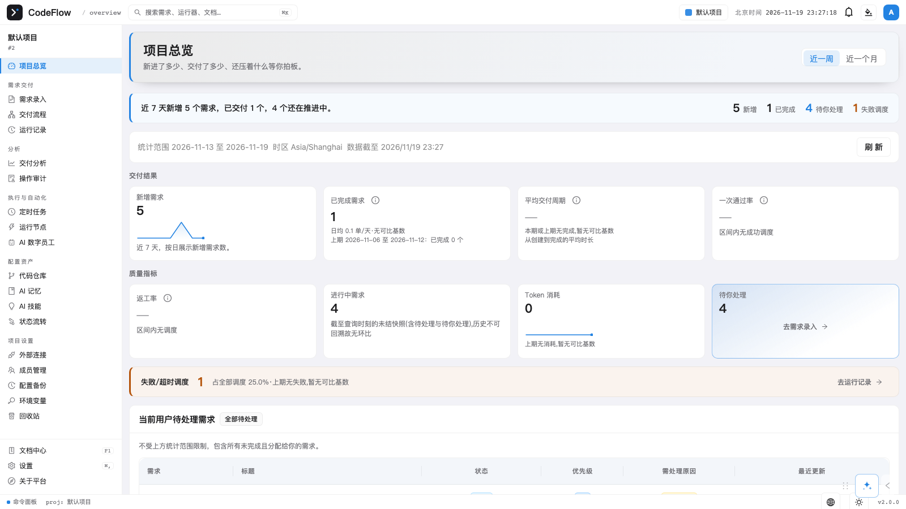
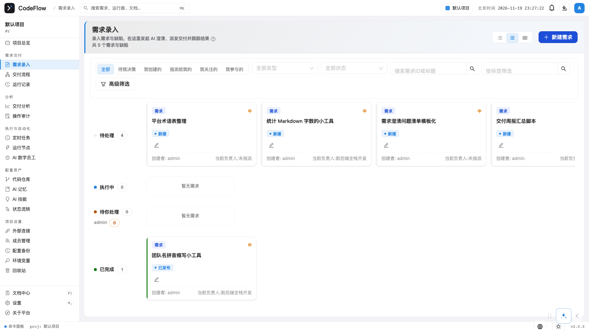
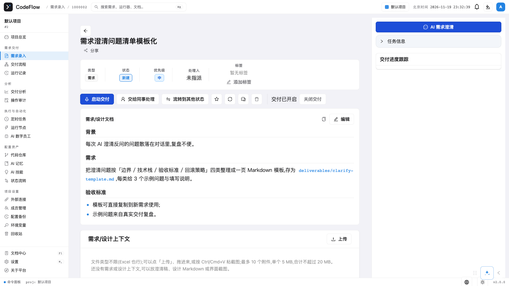
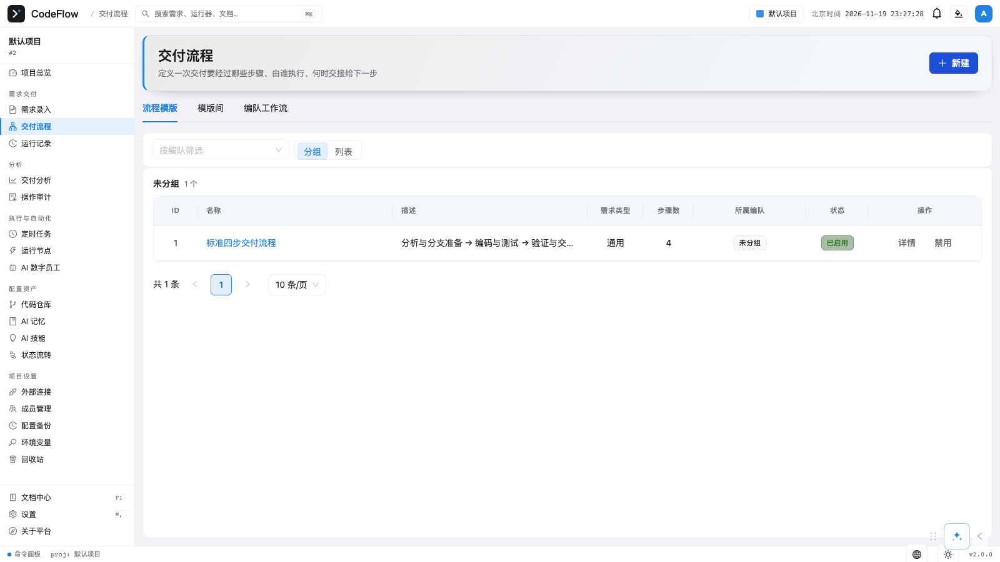
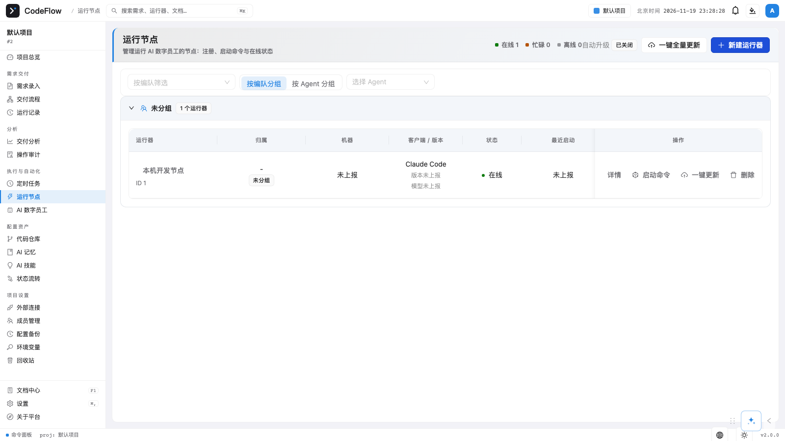
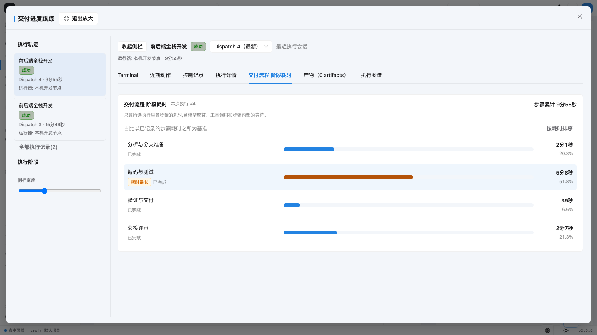
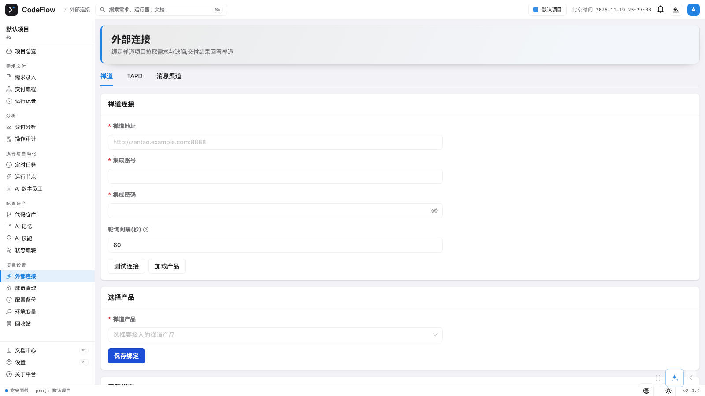
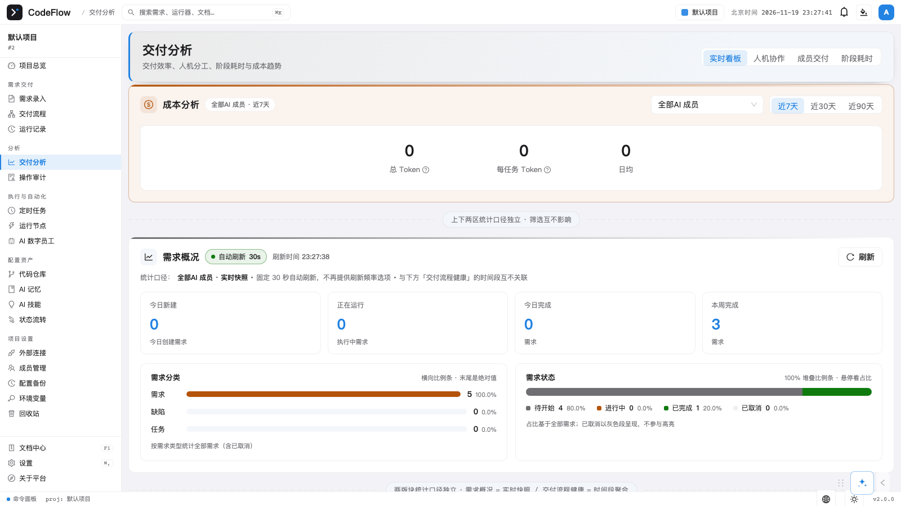

# 首发丨AI 会写代码了，然后呢？从个人 AI 到组织 AI

> 本文写给还没接触过这个平台的人：CodeFlow 是什么、解决什么问题、哪些坑让我改了设计、以及怎么在五分钟内跑起来。
>
> 全文约 6000 字，阅读时间 15 分钟。只想看部署命令的，直接拉到「上手」那一节。

---

先交代一下背景。

这两年 AI 编程工具的进化肉眼可见：Claude Code、Codex、Cursor、Gemini CLI、Qoder CLI，个个都能读懂仓库、改代码、跑测试。**写代码本身，已经不是瓶颈了。**

但真把一条需求从「提出来」走到「交付完」，你很快会撞上另一堵墙：这些工具再强，本质上都是**个人 AI**——每一次干活，都是你亲自发起。需求散在禅道、群里、口头里，你得自己把它们翻成一句话喂给 AI；它跑起来了，你得自己盯着；跑完了，你得自己验证、自己把结论同步回工单。**工具越是能干，人反而越是围着它转。**

一个人用 AI 很爽，可一旦需求多起来、人多起来，上下文就开始在人手里丢——切一次丢一次，换个人从头再来。

真正的坎不是「模型不够强」，而是**从个人 AI 到组织 AI 的这一步**：怎么让 AI 的每一次产出，不再躺在某个人的终端记录里，而是变成整个团队可查、可接、可审计的交付资产。

CodeFlow 就是冲着这一步来的：一套 AI 需求交付平台。它把需求到交付的整条链路管起来——需求怎么进来、AI 怎么接活、在哪台机器上干、产物和结论怎么留、人什么时候必须介入，每一步都有归属。

这一篇，我想认真讲讲它。

---

## 一、先说它解决什么问题

CodeFlow 解决的问题，全部长在一条真实的交付链路上。先把卡点摊开，一共四个：

**需求散落各处。** 禅道里一条、群里一句、会上口头提一嘴。两周之后没人说得清当时到底要什么——不是没人记得，是记得的人换了上下文。

**每一步做完就散了。** 方案在聊天记录里，代码在 Git 里，测试结果在某人的终端里，部署在另一台服务器上。单看每一步都做完了，拼在一起却回答不了一个问题：**这条需求现在到底走到哪了？**

**上下文跟着人走。** 一个人手上压着五条需求，切一次丢一次；换个人接手，前面所有的判断作废，从头再问一遍。

**出了问题没有证据。** 开发一句"是不是环境问题"，就能让所有讨论回到原点——因为你拿不出东西反驳。

我的结论是：**真正拖慢交付的，是上下文在人和工具之间反复丢失，是每一步做完就散了。** 写代码的速度救不了这个。

所以 CodeFlow 做的事情很克制：把一次交付拆成一条**有状态、可回看、可交接**的流水线。需求怎么进来、AI 怎么接活、在哪台机器上干、产物和结论怎么留、人什么时候必须介入——每一步都有归属。

一句话：**它不替你想清楚要做什么，它替你把做过的每一步留下来。**

下面第三节，我会跟着一条真实需求把这条旅程走一遍——六个节点，每一站长什么样、为什么这样设计。



项目总览。第一屏是一句结论加四个关键数字，而不是八个需要自己总结的方格。

---

## 二、它不做什么

划边界比吹功能重要，这部分我放在前面讲。

**它不是"一句话生成整个系统"的魔法。** 需求本身说不清，它救不了。我试过拿一句模糊的话直接开跑，AI 会停下来反问你——这不是缺陷，是设计。

**它不是又一个 AI 编程工具。** Claude Code、Codex、Cursor、Gemini、Qoder 这些是干活的手。CodeFlow 是派活、盯进度、收结果、留证据的那一层。手怎么用你自己选，平台六种 CLI 都支持，不绑厂商。

**它不替代需求管理和协作工具。** 需求在禅道里，就从禅道来；交付完了，结论写回禅道的评论。它不试图让你换掉已经在用的东西。

**它不能替你验收。** 产物、测试记录、部署结果都留给你了，但"这算不算做完了"这个问题，还是人回答。

这些边界不是没能力做，是**故意不做**。后面讲设计的时候你会看到，有几条边界我是用真 bug 换来的。

---

## 三、一条需求的完整旅程

这一节跟着一条真实需求走完全程。平台的全部能力，都长在这条旅程的六个节点上。

### 第 1 站丨需求进来

在「需求录入」写一条需求，或者让平台从禅道自动同步——绑定产品之后每 60 秒自动拉取，有更新才进来，重复拉取不会重复建单。需求一律进看板，按状态分列，谁该处理什么一目了然。



### 第 2 站丨AI 澄清，把"看起来清楚"问成"真的清楚"

启动交付之前，负责澄清的 AI 数字员工会先和你对话：边界在哪、技术栈定什么、验收标准是什么、失败了要不要回滚。我第一次跑的时候，AI 反问了 **19 个问题**。当时觉得啰嗦，后来意识到：这 19 个问题如果拖到开发一半才冒出来，每一个都是一次返工。

澄清结束产出 `spec.md` 和 `plan.md` 存进附件，**你确认了方案，才开工**。



### 第 3 站丨派发，按一条有名字的交付流程走

每个项目可以定义自己的交付流程：这条需求经过哪几步、每一步由哪个 AI 数字员工执行、干完交给谁。一条典型的交付流程是四步：分析与分支准备 → 编码与测试 → 验证与交付 → 交接评审。

点「启动交付」，选一个编队，需求就进入交付流程了。



### 第 4 站丨执行，发生在你自己的机器上

真正干活的是运行节点——装在你自己的笔记本、CI 机器或内网服务器上。平台把启动命令生成好，一键复制，粘贴执行，节点主动连上来。**代码在内网、被测系统在内网都没关系——节点主动往外连，平台不需要访问你的机器。**

节点上跑什么 CLI 你自己定：Claude Code、Codex、Cursor、Gemini、Qoder 都行，平台不绑厂商。



### 第 5 站丨过程有留痕，失败能重来

执行中的每一步都落在需求详情里：当前卡在哪一步、上一轮为什么失败、调试日志是什么。失败不会被吞掉，可以一键重新派发。成功的交付同样留痕——一次真实交付会归档 8 个产物，方案、代码、测试输出、部署记录分开存放。



### 第 6 站丨交付完成，结论回到源头

验收通过后，把需求流转到"已发布"。平台会自动把交付结论写回需求源头的评论（比如禅道），闭环有据。

这里有一条我用真 bug 换来的设计决策：**平台只回写交付备注，不代改外部单据的状态。** "已解决/关闭"必须由人在禅道侧按。为什么不做？因为"修没修好"是人的判断，让工具替人关单，看起来是自动化，实际上是把验收责任扔给了机器。



### 跑完之后，你得到的是什么

不是一个"做完了"的口头结论，而是一组能拿去复盘的数：需求量、平均交付周期、一次通过率、返工率、失败/超时调度、Token 消耗，以及需求分类和状态占比。哪一类需求总返工、哪一步在拖、成本花在哪——看数就知道。



---

## 四、四次真实交付

上面这条旅程不是画出来的，下面四个产品全部通过 CodeFlow 从需求开始交付，数字都是实测的。

### 性能测试平台（Web 压测工具）

Python 3 **仅标准库**，零 pip install。20 并发 × 50 次：**50/50 成功，QPS 1975.77，错误 0**。

这次交付撞上一个真缺陷：Python `socketserver` 默认 accept 队列只有 5，20 并发直接打满，内核重置了 36/50 个连接，成功率掉到 28%。把 `request_queue_size` 提到 512，回到 100%。

### 电商网站（商店 + 管理端）

Node.js 单进程，**零第三方运行时依赖**；内置 sqlite，降级可用。下单在单个事务里完成"校验 → 扣库存 → 建单"，失败整体回滚。

**验收**：浏览 → 加购 → 下单（订单号 NO202611120555218625）→ 管理端发货 → 已发货，全链路走通。

### 教师工作台

同样仅标准库。7 个模块、12 条路由；分数越界返回 400 且**整批不落库**；重启后数据一致；级联删除不留孤儿；**100 并发 0 失败**。

它和性能测试平台撞了同一个 accept 队列的坑。**第二次遇到，十分钟改完。** 坑被记下来，第二次就不是坑了——这也是我坚持"每个交付都留自测记录"的原因。

### 周报自动汇总

把多人周报合并成一份，按人分组、事项去重。这个案例暴露的是另一类问题：**产物上传后子目录丢了**——收集产物用了 `glob("*")` 只拿到第一层，改成 `rglob` 才完整。同类问题还有任务包摘要前导零被截断，校验必失败。

这类缺陷的共同点：单元测试全绿，但把产物拉下来跑不起来，等于没交付。**只有真的把产物当文件用，才会暴露。**

---

## 五、几个被我改过设计的地方

打磨这套平台的过程中，有几个地方是我主动改掉的，原因比功能本身更有意思。

**外部需求按谁绑定落到谁的项目。** 早期版本外部拉取统一落到默认工作区，结果多项目环境下一同步，需求全跑到一个项目里去了。改成按绑定的归属落库，并且每轮拉取都留同步记录，调度器判重才有依据。

**派发的任务包，先落事务再通知。** 早期版本先发通知再提交事务，执行器收到通知来下载，包还没落盘，404。改成事务提交之后再发通知，一次修复，再也没有复现过。

**任务包摘要逐字节补零。** 摘要用十六进制字符串传，前导零被丢掉，`0f` 变成 `f`，下载校验必失败。这种 bug 报错信息完全对不上根因，查了一下午。改成按字节补零之后根治。

**第一次注册的人必须是管理员。** 部署完发现平台配置入口全灰——因为注册接口固定写普通用户，而库里没有别人。全新部署等于没法用。改完之后，"注册即管理员"成为文档里明确的一条。

这些不是什么高深的设计，都是**部署一遍、真的用一遍**才会撞上的东西。也是我坚持"clone 即部署、一条命令起全栈"的原因——自己都不从零装一遍，就永远不知道哪里会断。

---

## 六、边界，说实话

**需求说不清，它救不了。** 澄清能把"没说清"问出来，但答案得在你心里。

**模型额度是真门槛。** 长任务中断在中间，重跑 Token 再花一遍。建议确定性任务用 Flash 模型，澄清和评审用旗舰模型。

**环境要自己装。** 运行节点上缺 JDK、Maven、Node，任务就会失败。平台派活，不装环境。

**它不是无人值守。** 需求澄清要你参与，方案确认要你点头，验收要你看。省掉的是"盯着干活"和"来回传话"，不是"做判断"。

**以上数据来自演示与真实交付环境的运行记录。** 不同团队的需求复杂度、模型选择和运行环境差异很大，建议先用一条真实需求试点，再决定要不要接入团队流程。

---

## 七、谁在用，怎么用

**独立开发者 / 一人多项目**：把并行需求的上下文交给平台，只处理澄清和验收，省掉来回切换的心智损耗。

**小团队负责人**：把交付过程标准化成流程模板，谁在做什么、卡在哪，看板一眼可见，不用开会问进度。

**平台与效能团队**：审计留痕、交付指标、外部系统对接都在平台内，可以作为研发效能体系的底座，API 可对接自建流水线。

**想转型 AI 交付的团队**：从一个需求、一个数字员工、一个运行节点开始，先跑通一条线，再扩展角色和并行度。

---

## 八、上手

```bash
git clone https://github.com/qsumm/CodeFlow.git && cd CodeFlow
cd platform
./deploy.sh up
```

seekdb + 应用 + 107 张表，一条命令全部就位。打开 `http://localhost:7001/register`，**注册的第一个账号即平台管理员**。

建议的上手顺序：先跑通**一条**需求（澄清 → 派发 → 验收），再给数字员工配运行节点，然后开始并行两条，最后把踩过的坑沉淀进技能和记忆。不要一上来就配四个角色。

---

## 写在最后

坦率讲，这套平台还有不少粗糙的地方：部分查询是手写 SQL，没有 ORM——每一行都看得见，代价是字段改起来比用框架费劲；前端有几个页面的历史包袱还在；多节点部署的密钥分发方案也还偏手工。这些都在待办清单上，会慢慢磨。

这套平台打磨到现在，登记过十四个交付缺陷，重写过一遍手册。它不是某个灵光一现的作品，更像是一段时间里**把"交付应该是什么样"这个问题反复问自己**的结果。

AI 的本质，从来都是以人为本。希望这套东西能帮你把重复的活交出去，把省下来的注意力，花在只有人能做的事情上。

---

**项目地址**：https://github.com/qsumm/CodeFlow
**部署**：`./deploy.sh up` · 数据库 seekdb · 表结构自动初始化

❤️ **关注公众号「一鸣AI编程」**，回复 **codeflow** 拿部署包和演示环境地址
❤️ 有问题欢迎留言，或者直接去仓库提 Issue
❤️ 觉得有用的话，顺手去仓库点个 Star，真的很重要
