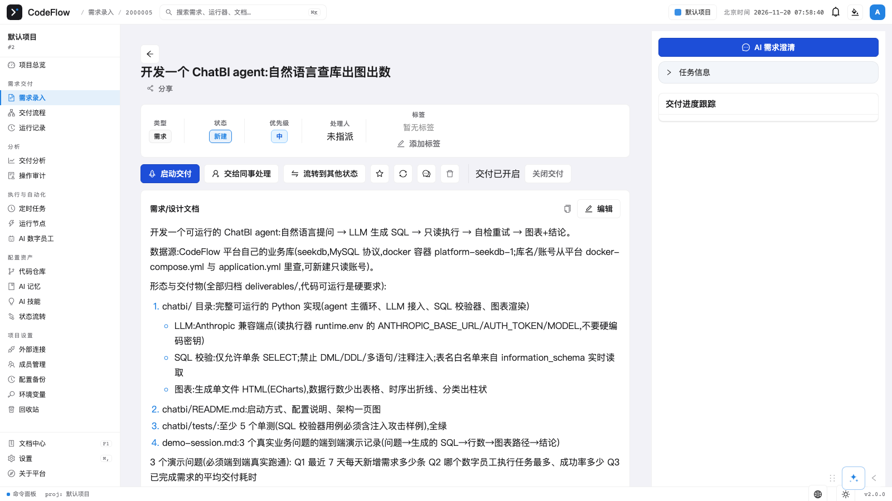
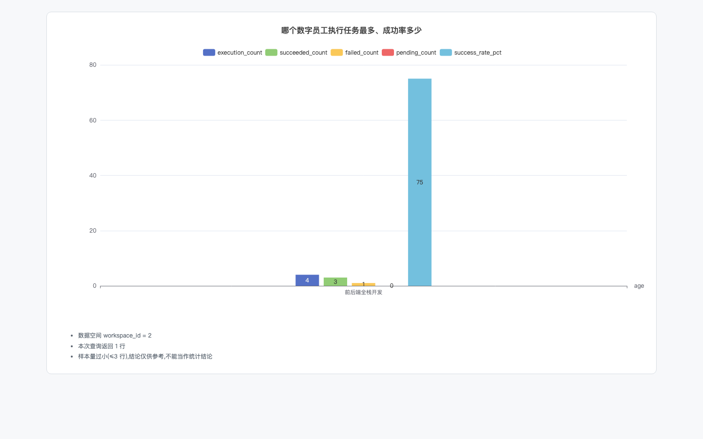
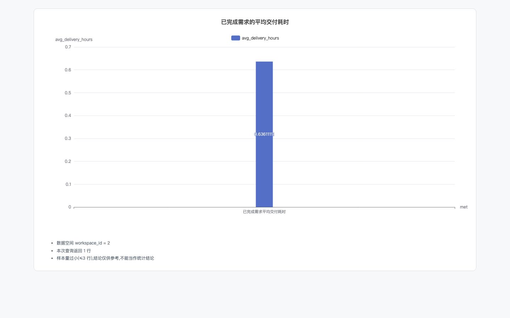
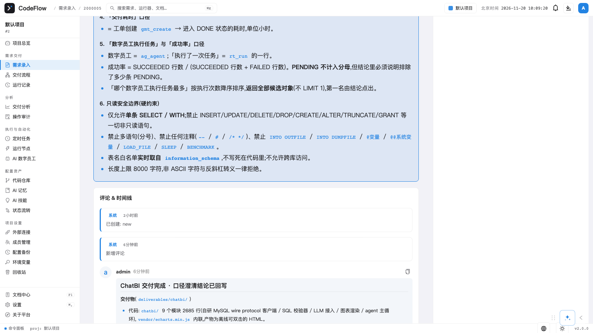
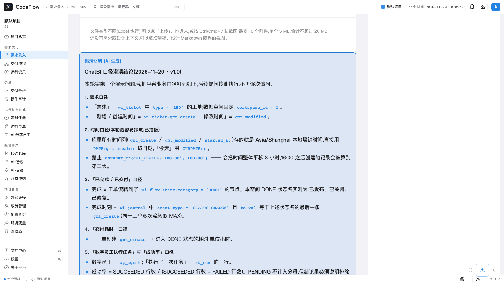

# 案例：用 CodeFlow 让数字员工交付一个真能跑的 agent

> 全程在本地 CodeFlow 平台操作，每一步留痕截图。8 张截图，按操作顺序编号。
>
> 需求是「开发一个 ChatBI agent」，交付物是一个可运行的软件：**2685 行纯标准库代码、150 个单测全绿、3 个真实问题端到端出图出数**。

## 一句话结论

**CodeFlow 不是一个「更会写代码的 AI」，是「让 AI 干活这件事有状态、可回看、可交接」的那一层。**

这个案例里它做三件事，都被真实验证过：

| 能力 | 验证结果 |
|---|---|
| 数字员工不是空对空聊天 | 它**自己连库勘察**（表行数、seekdb 版本、端口归属）、**自己读仓库规范**（`docs/00` 的零依赖条款），然后带着核实到的事实回来提问 |
| 数字员工能真的把活干完 | 交付 **2685 行**可运行代码（自研 MySQL 协议客户端 + SQL 校验器 + 图表渲染），**150 个单测全绿**，3 个真实问题端到端出图出数 |
| 交付过程可回看、可交接 | 澄清对话、口径结论、代码改动、产物清单、测试报告全部归档进平台需求详情 |

---

## 一、建需求


需求 #2000005：**开发一个 ChatBI agent**——自然语言提问 → LLM 生成 SQL → 只读执行 → 自检重试 → 图表 + 结论。

数据源直接用**平台自己的业务库**，所以演示自洽：ChatBI 分析的就是 CodeFlow 的交付数据。



需求里把交付物和验收标准写死了：4 个交付物（`chatbi/` 实现、README、≥5 个单测含注入样例、`demo-session.md`）、3 个必须端到端跑通的演示问题、4 条硬验收（能直接出图出数 / 单测全绿 / 注入样例全拦 / 只读账号拒写）。

## 二、澄清：它查了真实的库，然后问了 6 个必须人拍板的问题


数字员工这轮核实的事实，**全是它自己连库查出来的**，不是猜的：

| 它核实到的 | 影响 |
|---|---|
| seekdb 容器版本 `5.7.25-OceanBase seekdb-v1.4.0.0`、宿主端口 33060（`application.yml` 里的 2891 是另一个容器） | 决定连哪个库 |
| `wi_ticket` 11 条 / `rt_run` 6 条 / `ag_agent` 7 个 | 数据量薄，结论必须加样本量提示 |
| Q3「平均交付耗时」全库只有 1 个样本 | 必须提示「n=1，不能当统计结论」 |
| 需求原文要求「零第三方运行时依赖」，但仓库里**没有**纯 Python MySQL 驱动 | 规格与现实冲突，必须让人拍板 |
| `cdn.jsdelivr.net` 实测可达 | 影响 ECharts 内联还是 CDN |

它提的 6 个问题，每个都带 a/b/c 方案和推荐：

1. **MySQL 怎么连？** A 自研 wire protocol 客户端 / B PyMySQL（要豁免零依赖）/ C 调宿主 mysql CLI
2. **ECharts 怎么进单文件 HTML？** A 内联 vendor / B CDN
3. 工作区口径（11 条工单跨 5 个 workspace，不隔离的话数字没法解释）
4. 只读验收怎么算：A 校验器拦 / B DB 拒写
5. 交付物清单与仓库规范的六步文档链冲突
6. 代码真身放 `chatbi/` 还是 `deliverables/`

**拍板**：Q1→A（自研协议客户端，零依赖条款不许豁免）、Q2→A（内联 vendor）、Q4→两层都测、Q5→全套补齐、Q6→代码真身只在 `chatbi/`、Q3 按它默认。平台侧授权它写回澄清结论、用完撤销 MCP 令牌。

> 这一步是整个案例里最该看的：**人没有替它做技术判断，只在它列出的选项里选了一个。** 而它的选项建立在它自己查过的事实上。

## 三、交付：2685 行可运行代码

| 部分 | 行数 |
|---|---:|
| 实现（9 个模块：`agent` `mysql_client` `sql_guard` `llm` `chart` `config` `errors` `__main__` `__init__`） | 1676 |
| 测试（6 个测试文件 + conftest） | 1009 |
| **合计** | **2685** |

最硬的一块是 `mysql_client.py`（368 行）：**纯标准库实现的 MySQL wire protocol**，含 `mysql_native_password` 握手——因为仓库规范要求零第三方运行时依赖，而 PyMySQL 会破规矩。

## 四、三个演示问题，端到端出图出数


**Q1「最近 7 天每天新增需求多少条」**——LLM 生成的 SQL 用了递归 CTE 造日期序列（保证缺失日期补 0），7 行结果、折线图、附口径注释。



**Q2「哪个数字员工执行任务最多、成功率多少」**——结论：前后端全栈开发执行 4 次，成 3 败 1，**终态成功率 75.00%**，并明确注明「样本量过小（≤3 行），结论仅供参考」。



**Q3「已完成需求的平均交付耗时」**——行数太少，按设计降级为表格输出（0.64 小时）。

三问都走完「选表 → 生成 SQL → 只读校验 → 执行 → 自检 → 出图 → 结论」全链路。

## 五、自检：它自己发现了自己的口径错误

Q3 最能说明问题。**它生成的 SQL 用 `j.to_val IN ('已发布','已关闭','已修复')` 判定「已完成」，但自检环节发现这不能证明等价于平台的 DONE 状态**，可能纳入非完成需求、漏掉真正的 DONE，于是在结论里明确标注：

> 给定信息无法证明这三个值等价于 DONE，因此可能纳入非完成需求并漏掉真正的 DONE。应将条件改为 `j.to_val = 'DONE'`……

也就是说，**它没有把一个看起来能跑的答案当成正确答案交出来**，而是指出了自己口径的证据缺口。这正是澄清里定的「自检 → 带错误信息让 LLM 重生成（上限 3 次）」在起作用。

## 六、三层验收（独立复核，不是 AI 自述）

| 验收项 | 方法 | 结果 |
|---|---|---|
| 单测全绿 | `python3 -m pytest chatbi/tests -q` | ✅ **150 passed in 0.13s**（sql_guard 80 / mysql_client 22 / chart 13 / config 13 / agent 11 / integration 11） |
| 三问端到端出图 | `python3 -m chatbi "<问题>"` ×3 | ✅ 三问全跑通，3 张单文件 HTML（ECharts 内联，离线可看） |
| **A 层** 注入拦截 | 现场跑 10 类攻击样例 | ✅ **10/10 全拦**：DROP / UPDATE / DELETE / INSERT / 多语句 / 注释注入 / 危险函数 / 非白名单表 / UNION 注入 / 跨库；正常 SELECT 放行 |
| **B 层** 只读账号 | `chatbi_ro` 直连执行 UPDATE | ✅ 被 MySQL 拒：`UPDATE command denied to user 'chatbi_ro'@'%' for table 'wi_ticket'` |

AI 自己的口径是 **30 条注入样例 100% 拦截**（含 OUTFILE、超长、非 SELECT 开头等我抽测之外的类别）。

## 七、过程留痕：平台侧可见





澄清回合与口径结论都归档进需求详情，**不是散落在某个人的终端记录里**——这正是平台要解决的那个问题本身。

---

## 顺带修掉的两个运行器 bug

跑这条链路的过程中，运行器侧暴露出两个真 bug。**这类 bug 代码评审看不出来，必须真的多会话并发跑才现形**：

| Bug | 现象 | 根因 |
|---|---|---|
| 澄清会话首回合必失败 | `FileNotFoundError` | `runtime/daemon.py` 里 `workdir` 从未 mkdir，无 capability 包时落 `claude-settings.json` 直接失败 |
| **跨会话回合被误判为重复** | 新会话首回合被跳过，ACK 还回错会话 | 幂等键只用了 `turn_id`（它是**会话内序号**），应改为 `(conversation_id, turn_id)` 复合键 |

两个都已修复，并补了 12 条回归锁（`tests/test_conversation_regression.py`）。回归锁本身做了**变异测试**验证：回退修复后 6 条立刻失败，恢复后全绿。

---

## 截图索引

| # | 截图 | 环节 |
|---|---|---|
| 01 | `shots/01-需求表单-新建ChatBI.png` | 新建 ChatBI 需求（交付物与验收标准写死） |
| 02 | `shots/02-需求详情-ChatBI.png` | 需求详情 |
| 03 | `shots/03-发起澄清.png` | 发起澄清：「请通过平台 MCP 读需求…」 |
| 04 | `shots/04-图表-最近7天新增需求-折线.png` | Q1 折线图（递归 CTE 造日期序列） |
| 05 | `shots/05-图表-数字员工执行统计-柱状.png` | Q2 柱状图（成功率 75%） |
| 06 | `shots/06-图表-平均交付耗时-表格.png` | Q3 表格输出 |
| 07 | `shots/07-平台产物区.png` | 需求详情里的产物归档 |
| 08 | `shots/08-澄清结论与评论.png` | 澄清结论与评论写回平台 |

---

## 复现

```bash
python3 -m pytest chatbi/tests -q                    # 150 passed
python3 -m chatbi "最近 7 天每天新增需求多少条"        # 出图出数
python3 -m chatbi "哪个数字员工执行任务最多、成功率多少"
python3 -m chatbi "已完成需求的平均交付耗时"
ls deliverables/chatbi/charts/                        # 3 张单文件 HTML
```

交付物清单见 [`deliverables/chatbi/`](../deliverables/chatbi/)：01 立项说明 / 02 PRD / 03 设计文档 / 04 概要设计与接口数据库 / 05 测试文档 / 06 测试报告 / 07 缺陷修复记录 / spec.md / plan.md / demo-session.md。
