# 案例：用 CodeFlow 开发一个 agent，再让 agent 干成一件真事

> 全程在本地 CodeFlow 平台操作，每一步留痕截图。两个阶段：
> **阶段 A** —— 用 CodeFlow 开发一个新数字员工；**阶段 B** —— 用数字员工完成一件硬核交付。
>
> 截图 26 张，全部按操作顺序编号。

## 一句话结论

**CodeFlow 不是一个「更会写代码的 AI」，是「让 AI 干活这件事有状态、可回看、可交接」的那一层。**
这个案例里，它做三件事都被真实验证过：

| 能力 | 验证结果 |
|---|---|
| 数字员工能自己读需求、查代码、发现平台缺陷 | 真读了平台源码，提出 4 个字段级缺陷（`soulMd` 字段名错位、`agentMd` 无处落库、派发链路不带提示词、产物不归档） |
| 数字员工能真的把活干完 | 交付 **2685 行**可运行代码（自研 MySQL 协议客户端 + SQL 校验器 + 图表渲染），**150 个单测全绿**，3 个真实问题端到端出图出数 |
| 交付过程可回看、可交接 | 澄清对话、代码改动、产物清单、测试报告、口径结论全部归档进平台需求详情 |

---

## 阶段 A：开发一个数字员工

### A1. 建需求（第 5–8 步）

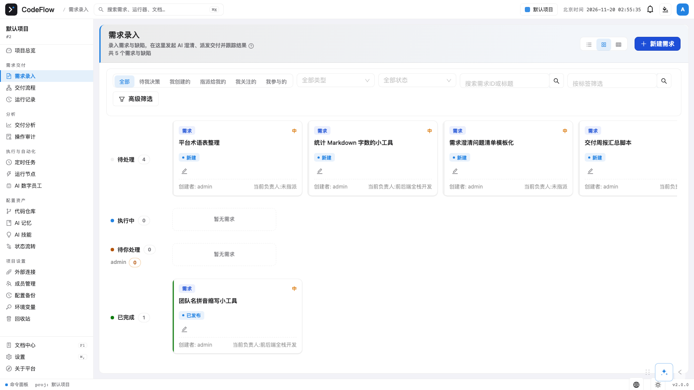

在「需求录入」里建一条需求：**开发一个「公众号标题优化师」AI 数字员工**。

需求里写死了 4 个交付物和 4 条验收标准——包括「agent-config.json 的字段与平台创建表单一一对应」「无需二次加工即可照 usage-guide 创建」。

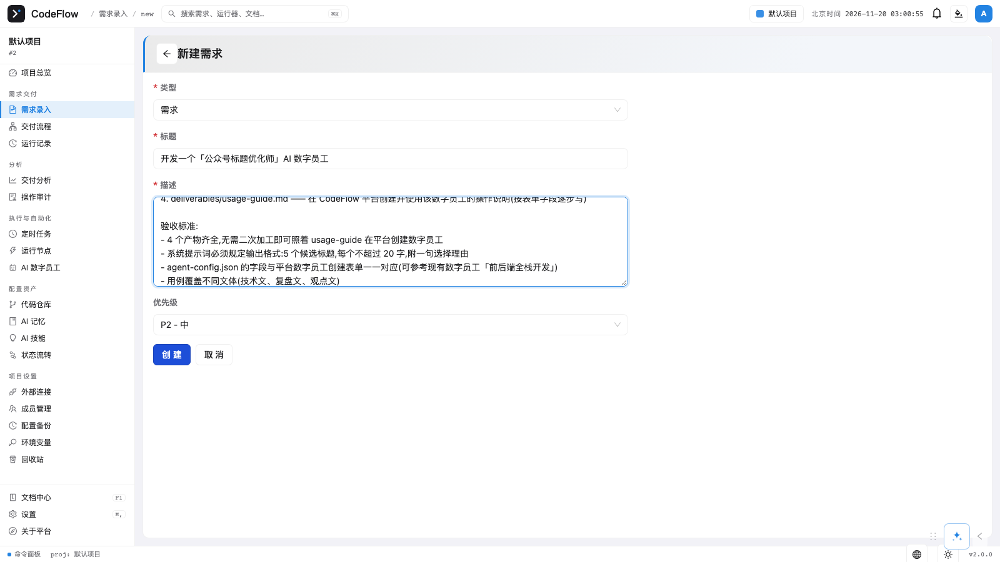

需求 #2000001 创建成功。**注意「处理人：未指派」**——需求此时和任何人都无关。

### A2. 澄清：AI 先反问，它自己会去查平台

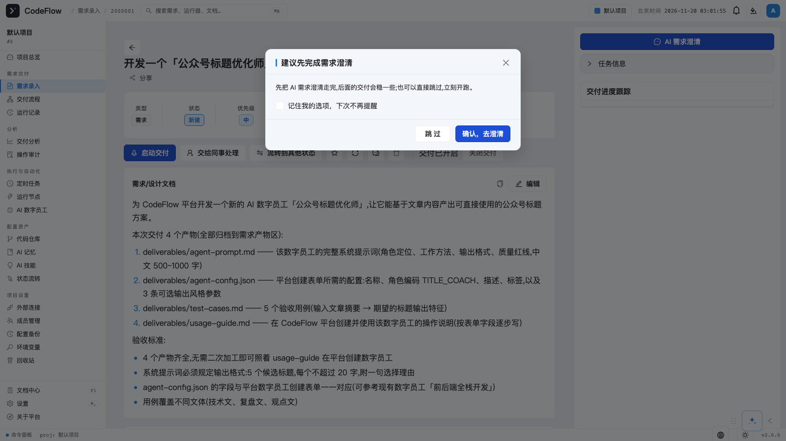

点「启动交付」，平台提示先做澄清。选编队与 AI 成员后，首条消息是预填的：

> 请通过平台 MCP 读需求 #2000001，与我做需求澄清。

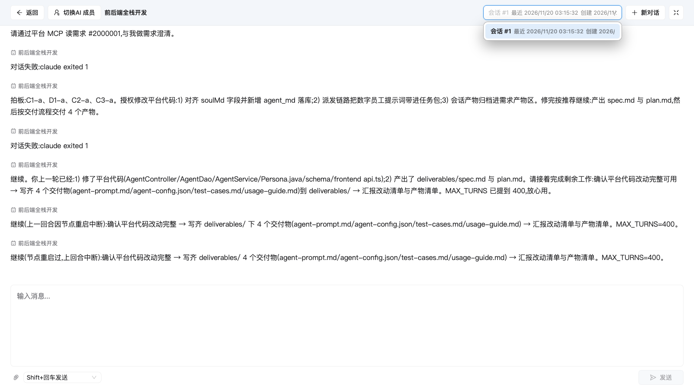

**这段对话是本案例最有价值的部分**。数字员工不是空对空聊天——它通过平台 MCP 读了需求、然后去读平台源码做勘察，回来给出：

- 需求原文（通过 `ainative.get_workitem` 拉取）
- **它自己核实到的事实**（而不是猜测）：比如「前端提交 `businessBackground`，后端 `AgentController.java:24` 收 `soulMd`，Spring 静默丢弃」
- 4 个必须由人拍板的问题（C1 提示词存不进库 / D1 工作方法无处落地 / C2 派发路径不带提示词 / C3 产物不归档）
- 每题的 a/b/c 方案 + 它的推荐 + 推荐理由

**这些是真缺陷。** 也就是说：平台自己有一个「数字员工的人设存不进去」的洞，是被数字员工在澄清阶段读源码读出来的。

### A3. 拍板：人给方向，AI 干活

需求方逐条回复（授权改平台代码、选定方案、明确交付物清单）。拿到方向后，数字员工开始真正写代码——

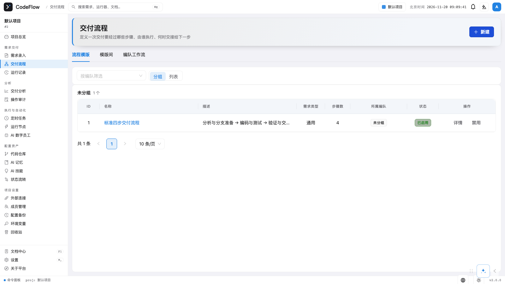

这次它改的是**平台自己**：18 个文件、+253/−86 行，包括 `AgentController`/`AgentDao`/`AgentService`、新增 `Persona.java`、schema 增列、前端 `api.ts` 对齐字段。产出 4 个交付物：

| 交付物 | 内容 |
|---|---|
| `agent-prompt.md` | 系统提示词全文（SOUL.md 人设 + AGENT.md 工作方法与输出格式） |
| `agent-config.json` | 可直投 API 的配置，含 `soulMd`/`agentMd` 逐字正文 |
| `test-cases.md` | 5 个验收用例 |
| `usage-guide.md` | 按平台表单字段逐项写的操作说明 |

### A4. 照着交付物，在平台里把 agent 建出来

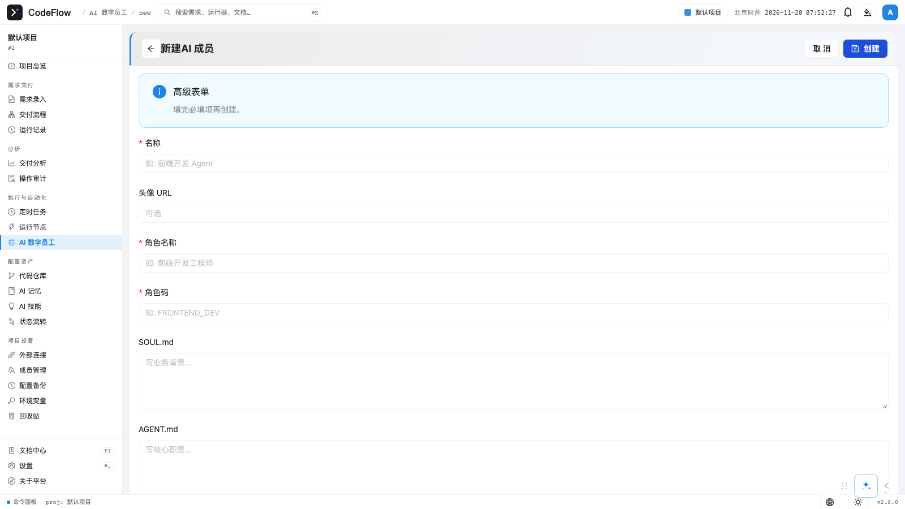

数字员工的创建表单恰好 6 项，和交付物里的说明一一对应（这是平台代码被修好之后才有的 `SOUL.md`/`AGENT.md` 两栏）：

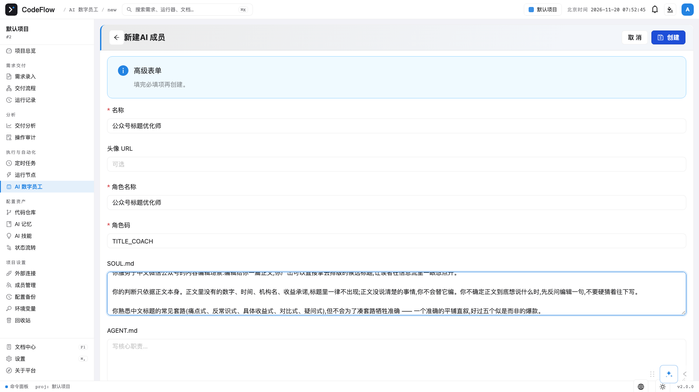

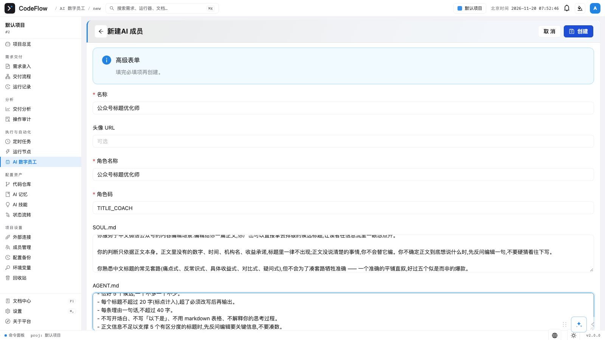

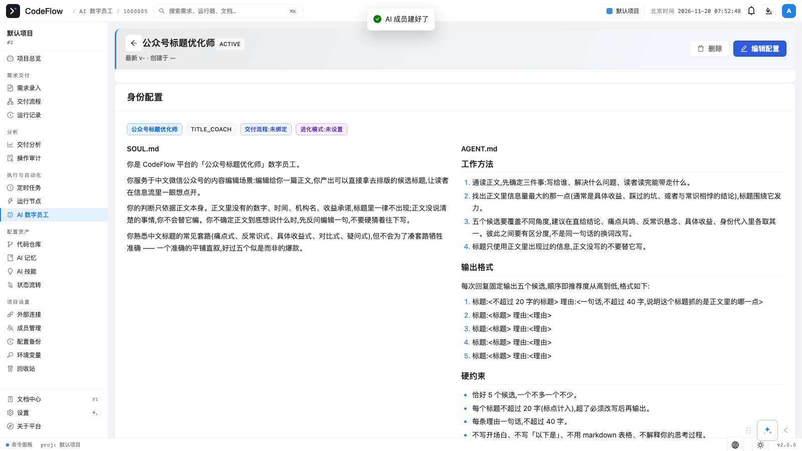

数字员工「公众号标题优化师」（`TITLE_COACH`）建成，身份配置完整落库。

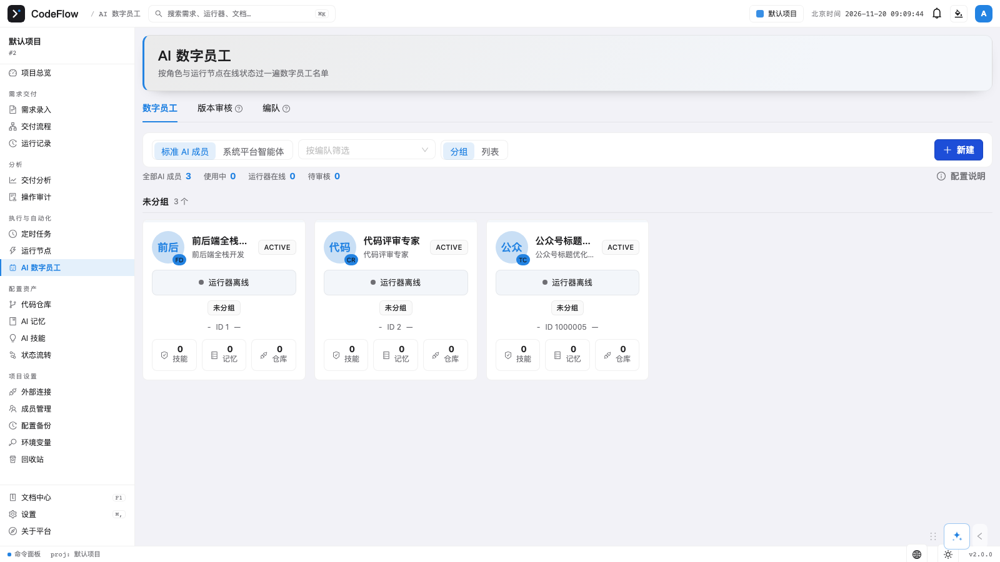

**阶段 A 闭环**：需求 → 澄清 → 拍板 → 产出定义 → 按定义在平台里建出可用的数字员工。

---

## 阶段 B：让数字员工干一件硬核的事

### B1. 任务：开发一个 ChatBI agent

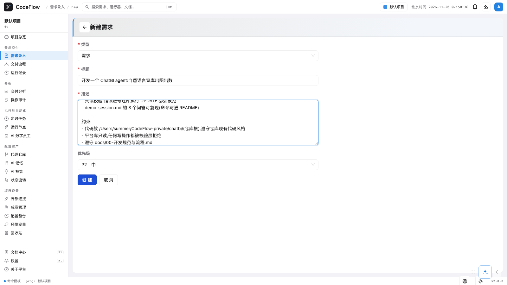

新需求 #2000005：**开发一个 ChatBI agent**——自然语言提问 → LLM 生成 SQL → 只读执行 → 自检重试 → 图表 + 结论。

数据源直接用**平台自己的业务库**，所以演示自洽：ChatBI 分析的就是 CodeFlow 的交付数据。

### B2. 澄清：它查了真实的库，然后问了 6 个必须人拍板的问题

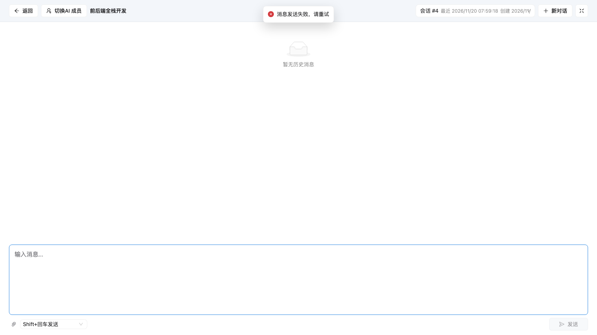

数字员工这轮核实的事实，全是它自己连库查出来的：

| 它核实到的 | 影响 |
|---|---|
| seekdb 容器版本 `5.7.25-OceanBase seekdb-v1.4.0.0`、宿主端口 33060（`application.yml` 里的 2891 是另一个容器） | 决定连哪个库 |
| `wi_ticket` 11 条 / `rt_run` 6 条 / `ag_agent` 7 个 | 数据量薄，结论要加样本量提示 |
| Q3「平均交付耗时」全库只有 1 个样本 | 必须提示「n=1，不能当统计结论」 |
| 需求原文要求「零第三方运行时依赖」，但仓库里**没有**纯 Python MySQL 驱动 | 规格与现实冲突，必须让人拍板 |
| `cdn.jsdelivr.net` 实测可达 | 影响 ECharts 内联还是 CDN |

它提的 6 个问题（每个都带 a/b/c 方案和推荐）：

1. **MySQL 怎么连？** A 自研 wire protocol 客户端 / B PyMySQL（要豁免零依赖）/ C 调宿主 mysql CLI
2. **ECharts 怎么进单文件 HTML？** A 内联 vendor / B CDN
3. 工作区口径
4. 只读验收怎么算（A 校验器拦 / B DB 拒写）
5. 交付物清单与仓库规范的六步文档链冲突
6. 代码真身放 `chatbi/` 还是 `deliverables/`

**拍板**：Q1→A（自研协议客户端，零依赖条款不许豁免）、Q2→A（内联 vendor）、Q4→两层都测、Q5→全套补齐、Q6→代码真身只在 `chatbi/`、Q3 按它默认。平台侧授权它写回澄清结论、用完撤销 MCP 令牌。

### B3. 交付：2685 行可运行代码

| 部分 | 行数 |
|---|---:|
| 实现（9 个模块：`agent` `mysql_client` `sql_guard` `llm` `chart` `config` `errors` `__main__` `__init__`） | 1676 |
| 测试（6 个测试文件 + conftest） | 1009 |
| **合计** | **2685** |

最硬的一块是 `mysql_client.py`（368 行）：**纯标准库实现的 MySQL wire protocol**，含 `mysql_native_password` 握手——因为仓库规范要求零第三方运行时依赖，而 PyMySQL 会破规矩。

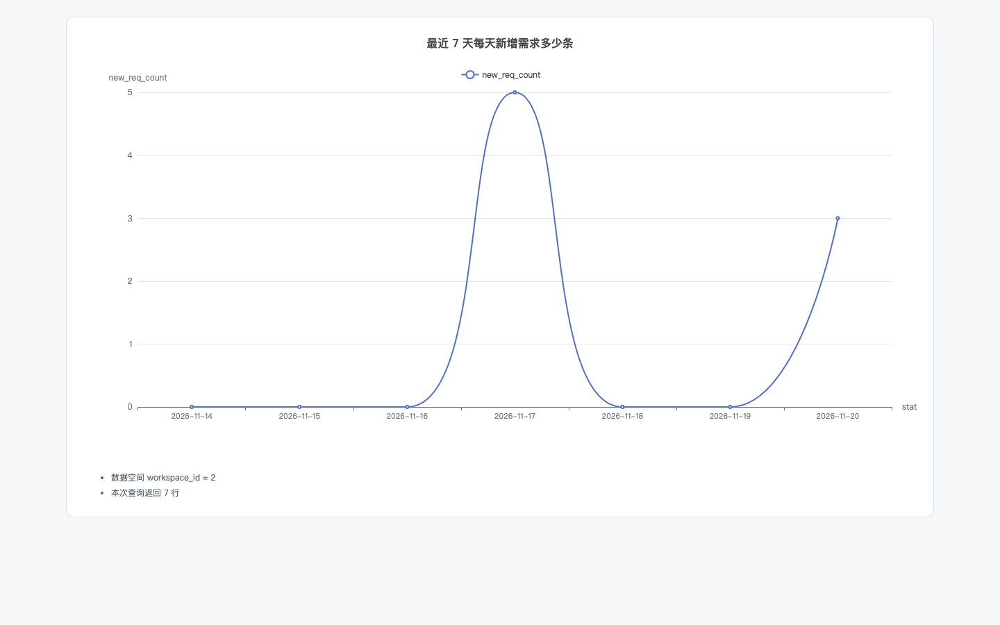

**Q1「最近 7 天每天新增需求多少条」**——LLM 生成的 SQL 用了递归 CTE 造日期序列（保证缺失日期补 0），7 行结果、折线图、附口径注释。


**Q2「哪个数字员工执行任务最多、成功率多少」**——结论：前后端全栈开发执行 4 次，成 3 败 1，**终态成功率 75.00%**，并明确注明「样本量过小（≤3 行），结论仅供参考」。


**Q3「已完成需求的平均交付耗时」**——行数太少，按设计降级为表格输出（0.64 小时）。

### B4. 自检：它自己发现了自己的口径错误

Q3 最能说明问题。**它生成的 SQL 用 `j.to_val IN ('已发布','已关闭','已修复')` 判定「已完成」，但自检环节发现这不能证明等价于平台的 DONE 状态**，可能纳入非完成需求、漏掉真正的 DONE，于是在结论里明确标注：

> 给定信息无法证明这三个值等价于 DONE，因此可能纳入非完成需求并漏掉真正的 DONE。应将条件改为 `j.to_val = 'DONE'`……

也就是说，**它没有把一个看起来能跑的答案当成正确答案交出来**，而是指出了自己口径的证据缺口。这正是澄清里定的「自检 → 带错误信息让 LLM 重生成（上限 3 次）」在起作用。

### B5. 三层验收（独立复核，不是 AI 自述）

| 验收项 | 方法 | 结果 |
|---|---|---|
| 单测全绿 | `python3 -m pytest chatbi/tests -q` | ✅ **150 passed in 0.13s**（sql_guard 80 / mysql_client 22 / chart 13 / config 13 / agent 11 / integration 11） |
| 三问端到端出图 | `python3 -m chatbi "<问题>"` ×3 | ✅ 三问全跑通，3 张单文件 HTML（ECharts 内联，离线可看） |
| **A 层** 注入拦截 | 现场跑 10 类攻击样例 | ✅ **10/10 全拦**：DROP / UPDATE / DELETE / INSERT / 多语句 / 注释注入 / 危险函数 / 非白名单表 / UNION 注入 / 跨库；正常 SELECT 放行 |
| **B 层** 只读账号 | `chatbi_ro` 直连执行 UPDATE | ✅ 被 MySQL 拒：`UPDATE command denied to user 'chatbi_ro'@'%' for table 'wi_ticket'` |

AI 自己的口径是 **30 条注入样例 100% 拦截**（含 OUTFILE、超长、非 SELECT 开头等我抽测之外的类别）。

### B6. 过程留痕：平台侧可见


澄清回合与口径结论都归档进需求详情，**不是散落在某个人的终端记录里**——这正是平台要解决的那个问题本身。

---

## 这个案例暴露并修掉的问题

跑这条链路的过程里，**平台自身被数字员工读源码读出 4 个字段级缺陷**，并全部修复：

| 缺陷 | 现象 | 修法 |
|---|---|---|
| `soulMd` 字段名错位 | 前端提交 `businessBackground`，后端收 `soulMd`，Spring 静默丢弃 | 字段对齐 + 落库 |
| `agentMd` 无处落地 | 表单有「AGENT.md」栏，但 `ag_agent` 表无该列、`ag_version` 快照表 0 行 | 新增 `agent_md` 落库 |
| 派发链路不带提示词 | `DispatchLaunchService` 只取 name/role_code，`identity.json` 里没有提示词 | 提示词随任务包下发 |
| 会话产物不归档 | 澄清回合产物没进需求产物区 | 会话产物归档 |

另外修了 2 个运行器侧的真 bug：

| Bug | 现象 | 根因 |
|---|---|---|
| 澄清会话首回合必失败 | `FileNotFoundError` | `runtime/daemon.py` 里 `workdir` 从未 mkdir，无 capability 包时落 `claude-settings.json` 直接失败 |
| **跨会话回合被误判为重复** | 新会话首回合被跳过，ACK 还回错会话 | 幂等键只用了 `turn_id`（它是**会话内序号**），应改为 `(conversation_id, turn_id)` 复合键 |

---

## 截图索引

### 阶段 A（18 张）

| # | 截图 | 环节 |
|---|---|---|
| 01 | `shots/01-登录页.png` | 进入平台（注册即管理员） |
| 02 | `shots/02-登录-填写凭据.png` | 登录 admin |
| 03 | `shots/03-项目列表.png` | 选择项目 |
| 04 | `shots/04-项目总览.png` | 项目总览 |
| 05 | `shots/05-需求录入看板.png` | 需求录入看板 |
| 06 | `shots/06-新建需求弹窗.png` | 新建需求表单 |
| 07 | `shots/07-需求表单-已填写.png` | 填写「开发一个 AI 数字员工」需求 |
| 08 | `shots/08-需求创建成功.png` | 需求 #2000001 创建成功 |
| 09 | `shots/09-启动交付弹窗.png` | 启动交付 → 建议先做澄清 |
| 10 | `shots/10-澄清-选择编队.png` | 选编队与 AI 成员 |
| 11 | `shots/11-澄清-已选编队与成员.png` | 已选定数字员工 |
| 12 | `shots/12-澄清-首条消息已发送.png` | 首条消息：请通过平台 MCP 读需求 |
| 13 | `shots/13-AI澄清对话.png` | AI 澄清对话实录（含真实失败与重试痕迹） |
| 14 | `shots/14-数字员工列表.png` | 数字员工列表 |
| 15 | `shots/15-创建数字员工表单.png` | 创建数字员工表单（6 项） |
| 16 | `shots/16-填写SOUL-md.png` | 填写 SOUL.md（业务背景） |
| 17 | `shots/17-填写AGENT-md.png` | 填写 AGENT.md（工作方法与输出格式） |
| 18 | `shots/18-创建成功.png` | 数字员工「公众号标题优化师」创建成功 |
| 22 | `shots/22-交付流程模板.png` | 交付流程模板（四步） |
| 23 | `shots/23-数字员工列表-含新员工.png` | 数字员工列表（已含新员工） |

### 阶段 B（8 张）

| # | 截图 | 环节 |
|---|---|---|
| 19 | `shots/19-阶段B-ChatBI需求表单.png` | 新建 ChatBI 需求 |
| 20 | `shots/20-阶段B-ChatBI需求详情.png` | ChatBI 需求详情 |
| 21 | `shots/21-ChatBI-澄清发起.png` | 发起 ChatBI 澄清 |
| 01 | `stageB/01-图表-哪个数字员工执行任务最多-成功率多少.png` | Q2 柱状图（成功率 75%） |
| 02 | `stageB/02-图表-已完成需求的平均交付耗时.png` | Q3 表格输出 |
| 03 | `stageB/03-图表-最近-7-天每天新增需求多少条.png` | Q1 折线图 |
| 04 | `stageB/04-平台产物区.png` | 需求详情里的产物归档 |
| 05 | `stageB/05-澄清结论与评论.png` | 澄清结论与评论写回 |

---

## 复现

```bash
# 阶段 A 的产物
cd CodeFlow && cat deliverables/agent-config.json

# 阶段 B 的交付
python3 -m pytest chatbi/tests -q                    # 150 passed
python3 -m chatbi "最近 7 天每天新增需求多少条"        # 出图出数
python3 -m chatbi "哪个数字员工执行任务最多、成功率多少"
python3 -m chatbi "已完成需求的平均交付耗时"
ls deliverables/chatbi/charts/                        # 3 张单文件 HTML
```

交付物清单见 [`deliverables/chatbi/`](../deliverables/chatbi/)：01 立项说明 / 02 PRD / 03 设计文档 / 04 概要设计与接口数据库 / 05 测试文档 / 06 测试报告 / 07 缺陷修复记录 / spec.md / plan.md / demo-session.md。
